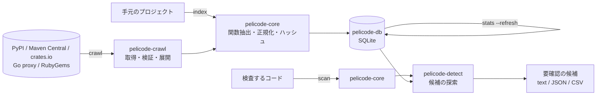

# pelicode 仕様書

[English](spec.md) | 日本語

> 対象: pelicode v0.1 の実装（2026-10-17 時点）。
> 未実装の機能は、本文中で「未実装」と明記し、[§12](#12-実装状況と今後) にまとめる。

## 目次

1. [目的と位置づけ](#1-目的と位置づけ)
2. [基本概念と用語](#2-基本概念と用語)
3. [システムの全体像](#3-システムの全体像)
4. [特徴抽出（pelicode-core）](#4-特徴抽出pelicode-core)
5. [参照データベース（pelicode-db）](#5-参照データベースpelicode-db)
6. [収集（pelicode-crawl）](#6-収集pelicode-crawl)
7. [検出（pelicode-detect）](#7-検出pelicode-detect)
8. [インタフェース](#8-インタフェース)
9. [非機能要件と設計原則](#9-非機能要件と設計原則)
10. [開発と配布](#10-開発と配布)
11. [評価](#11-評価)
12. [実装状況と今後](#12-実装状況と今後)

---

## 1. 目的と位置づけ

### 1.1 目的

ソフトウェアは、もはや開発者自身だけが書くものではない。AI アシスタントがコードを生成し、面識のない貢献者から PR が届く。そのコードがどこかからコピーされたものかどうかを、レビューですべて見極めることはできない。

pelicode は、公開パッケージの関数を収集してデータベースに蓄え、開発中のコードの関数をそれと照合して、**確認が必要な類似コードの候補**を出典とライセンスを添えて示す。dependabot が依存ライブラリのバージョンを外部のリポジトリと照合するのと同じ発想で、コードそのものを照合する。

### 1.2 位置づけ

- pelicode は、盗用やライセンス違反を**判定しない**。示すのは「要確認の候補」であり、流用かどうか、問題があるかどうかは人が判断する。
- 本プロジェクトの研究上の主眼は**検出方式**（関数単位の特徴表現、候補の検索、規模を大きくしたときの精度と速度）にある。PR の検査などの利用形態は、その応用である。利用シナリオは [scenario.ja.md](scenario.ja.md) にまとめる。

### 1.3 研究の問い

関数単位でコードの構造的な特徴を抽出し、類似候補を効率よく検索することで、文字列やトークンの単純な照合よりも識別子の変更などに強く、しかも大規模なコード集合に適用できる検出方式を実現できるか。

付随する問い:

- 関数という単位は、どの条件で有効で、どの条件で限界があるか（短い関数、関数の分割・統合、コードの移動）。
- 偶然の一致を避けるには、どの程度の関数の大きさ（トークン数）が必要か。
- データベースを大きくしたとき、再現率・適合率・検索時間・容量はどう変わるか。

### 1.4 対象範囲

| 項目 | 範囲 |
| --- | --- |
| 類似の種類 | クローンの慣例的な分類のうち Type-1（書式・コメントだけが違う）、Type-2（識別子・リテラル・型も違う）、Type-3（文の追加・削除・変更がある）。Type-4（意味は同じで構文が違う）は対象外 |
| 言語 | Go、Java、Kotlin、Python、Ruby、Rust（§4.1） |
| 公開リポジトリ | PyPI、Maven Central、Go モジュールプロキシ、RubyGems、crates.io（§6） |
| 照合の単位 | 関数（メソッド、コンストラクタ、ラムダ、ブロック、クロージャを含む） |

---

## 2. 基本概念と用語

| 用語 | 意味 |
| --- | --- |
| 関数（function unit） | 照合の単位。言語ごとに、関数とみなす構文要素を決める（§4.1）。 |
| 正規化 | コメントや書式、識別子の名前など、表面的な違いを取り除く処理。N0〜N3 の4段階（§4.2）。 |
| 完全ハッシュ（exact hash） | 正規化後のトークン列全体のハッシュ。完全一致の検出に使う。 |
| k-gram | 連続する k 個のトークン。 |
| フィンガープリント | k-gram のハッシュから winnowing で選んだもの。関数ごとの集合を比べて、部分的な一致を検出する。 |
| MinHash / LSH | フィンガープリント集合の要約と、それを使った候補の絞り込み。 |
| パッケージ / バージョン | エコシステム内の名前付きの単位と、その1リリース。 |
| 出現（occurrence） | 保存された関数が見つかった場所（パッケージのバージョンのファイル）。 |
| 出現パッケージ数（文書頻度、df） | あるハッシュを含むパッケージの数。 |
| ありふれたハッシュ | 多くのパッケージに現れ、流用の証拠にならないハッシュ。 |
| 候補（candidate） | 検査した関数と類似していると報告される、保存済みの関数。判定ではなく要確認の対象。 |

---

## 3. システムの全体像

### 3.1 2つの役割

pelicode の利用は、2つの役割に分かれる。

1. **参照 DB を作る側**: 公開パッケージを収集し（`crawl`）、または手元のプロジェクトを登録して（`index`）、関数の特徴を SQLite のデータベースに蓄える。蓄えた後、ハッシュごとの出現パッケージ数を集計する（`stats --refresh`）。
2. **検査する側**: 検査したいコード（ディレクトリ、または git の差分）から関数の特徴を取り出し、データベースを検索して候補を報告する（`scan`）。

両者は同じ特徴抽出の処理を通る。照合が成り立つ前提は、参照側と検査側で正規化とハッシュの計算方法が完全に一致することであり、これをデータベースに記録したパラメータで保証する（§4.4）。

### 3.2 構成要素



| crate（ディレクトリ） | 役割 | 依存先 |
| --- | --- | --- |
| pelicode-core（`core`） | 構文解析、関数抽出、正規化、ハッシュ・フィンガープリント・MinHash・LSH の計算、ファイルの探索 | - |
| pelicode-db（`db`） | SQLite への保存と検索、互換性の検査、出現パッケージ数の集計 | core |
| pelicode-detect（`detect`） | 候補の探索と類似度の計算 | core、db |
| pelicode-crawl（`crawl`） | 公開リポジトリからの取得、改ざん検査、アーカイブの読み取り、ライセンスの識別 | core、db |
| pelicode（`cli`） | `pelicode` コマンド。git の差分の解釈と出力の整形を含む | すべて |

---

## 4. 特徴抽出（pelicode-core）

### 4.1 関数単位

構文解析には Tree-sitter を使う。言語ごとに「関数とみなすノード」「コメント」「識別子」「型名」「文字列」「数値」のノード種別を言語アダプタ（`LanguageSpec`）として定め、言語の追加はアダプタの追加で行う。

| 言語 | 拡張子 | 文法 | 関数とみなすノード |
| --- | --- | --- | --- |
| Go | `.go` | tree-sitter-go | `function_declaration`、`method_declaration`、`func_literal` |
| Java | `.java` | tree-sitter-java | `method_declaration`、`constructor_declaration`、`compact_constructor_declaration`、`lambda_expression` |
| Kotlin | `.kt`、`.kts` | tree-sitter-kotlin-ng（コミュニティ製） | `function_declaration`、`secondary_constructor`、`anonymous_function`、`lambda_literal`、`getter`、`setter` |
| Python | `.py` | tree-sitter-python | `function_definition`、`lambda` |
| Ruby | `.rb` | tree-sitter-ruby | `method`、`singleton_method`、`lambda`、`block`、`do_block` |
| Rust | `.rs` | tree-sitter-rust | `function_item`、`closure_expression`（本体のないトレイトのメソッド宣言は対象外） |

抽出の規則:

- 入れ子の関数は、外側と内側をそれぞれ1つの関数として抽出し、親子関係を記録する。ただし、関数ノードの直下にある関数ノード（Ruby の `-> { }` とその中のブロックなど）は1つとみなす。
- 構文エラーを含む関数は抽出しない（同じファイルの他の関数は抽出する）。
- 関数名は表示用であり、照合には使わない。名前のない関数は `<anonymous>`、Kotlin のアクセサは `get` / `set`、二次コンストラクタは `constructor` とする。
- 関数ごとに、行・桁（1 始まり）とバイト範囲（0 始まり、終端を含まない）を記録する。

### 4.2 正規化

関数の構文木を前順にたどってトークン列を作り、4つのレベルの表現を得る。

| レベル | 内容 | 吸収できる違い |
| --- | --- | --- |
| N0 | コメントと空白を除いたトークン列 | 書式、コメント（Type-1） |
| N1 | N0 の識別子を `$ID`、文字列を `$STR`、数値を `$NUM`、真偽値を `$BOOL` に置き換えたもの。型名はそのまま | 名前の変更、リテラルの変更（Type-2） |
| N2 | N1 の型名も `$TYPE` に置き換えたもの | 型名の変更 |
| N3 | 名前付きノードの種類の前順系列（字句の内容を捨てる） | トークン単位の多くの変更（Type-3 の一部） |

共通の規則:

- 文字列リテラル（補間を含む）は1トークンとし、中に立ち入らない。
- Python の関数本体の先頭にある docstring は、すべてのレベルで除く。
- Go、Kotlin、Python、Ruby では、省略可能な文末の `;` を除く（改行で終わる文との違いをなくすため）。Java と Rust では `;` に構文上の意味があるので残す。
- 型名とみなすのは、言語アダプタが型名として定めたノード（Java・Go の `type_identifier`、Ruby の定数など）と、型を表す文脈（Python の `type`、Kotlin の `user_type`）の中の識別子である。
- 識別子の抽象化は2通りから選べる（`--ident-mode`）。`uniform`（既定）はすべてを `$ID` にし、`indexed` は関数内で最初に現れた順に `$ID1`、`$ID2`、…と番号を振る。

正規化の規則には版（`NORMALIZER_VERSION`、現在 1）を付ける。版の異なる特徴は比較できない（§4.4）。

### 4.3 特徴量

関数ごとに次を計算する。

| 特徴量 | 計算方法 | 用途 |
| --- | --- | --- |
| 大きさ | N0 のトークン数、名前付きノード数、構文木の深さ | 小さい関数の除外、統計 |
| 完全ハッシュ | 各レベルのトークン列を、区切り文字（0x1F）を挟んで BLAKE3 にかけた先頭 128 ビット | 完全一致の検索（N0〜N2）、記録（N3） |
| k-gram ハッシュ | 各トークンを xxh3（64 ビット）でハッシュし、連続する k 個のハッシュ列を再び xxh3 にかけたもの。トークン数が k 未満なら全体で1つ | フィンガープリントの元 |
| フィンガープリント | k-gram ハッシュの列に winnowing（窓幅 w）を適用し、各窓の最小値（同値なら右端）を選んだもの。それぞれに、k-gram がソース上で占める行範囲を付ける | 部分一致の比較、一致した行の表示 |
| MinHash | フィンガープリント集合の長さ n のシグネチャ。i 番目の値は、各ハッシュ h について splitmix64(h xor splitmix64(i)) の最小値 | LSH の入力 |
| LSH バケット | MinHash を b 個のバンド（各 n/b 行）に分け、バンドごとに xxh3（シードはバンド番号）でハッシュしたもの | 候補の絞り込み |

フィンガープリント、MinHash、LSH バケットは、トークン数が `min_tokens` 以上の関数についてだけ、指定したレベル（`--levels`、既定は N1）で計算する。短い関数は偶然に一致しやすいためである。短い関数にも完全ハッシュは記録する。

winnowing の性質として、w + k − 1 トークン以上の共通部分を持つ2つの関数は、少なくとも1つのフィンガープリントを共有する。

### 4.4 パラメータと互換性

| パラメータ | オプション | 既定値 |
| --- | --- | --- |
| 最小トークン数 | `--min-tokens` | 50 |
| 識別子の抽象化 | `--ident-mode` | `uniform` |
| k | `--kgram` | 10 |
| winnowing の窓幅 w | `--window` | 4 |
| MinHash の長さ n | `--minhash-size` | 128 |
| LSH のバンド数 b | `--bands` | 32（n を割り切る値） |
| フィンガープリントのレベル | `--levels` | N1 |

正規化の版、`ident_mode`、k、w、n、b はハッシュの値を左右するので、データベースに記録する（§5.2 の `meta`）。

- 記録と異なる値でデータベースに追加しようとすると、エラーにする。
- 検査（`scan`）は、データベースに記録された値を読み、それに合わせて検査対象の特徴を計算する。
- k の既定値は、当初 5 だったものを予備的な観察（§11.2）に基づいて 10 に変えた。

---

## 5. 参照データベース（pelicode-db）

### 5.1 設計方針

- **ソースコードを保存しない**。保存するのはハッシュ、位置（行・バイト範囲）、出典（パッケージ・バージョン・パス・取得元 URL・アーカイブのハッシュ）、ライセンスだけである。データベースが流出しても、他者のコードは漏れない。原典は出典の情報から取り直せる。
- **ファイルは内容で同一視する**。関数はファイルの内容（SHA-256）に結び付け、ファイルとパッケージのバージョンは多対多で結ぶ。バージョン間で変わらないファイルの特徴は、一度だけ保存する。
- **互換性を検査する**。テーブル構成の版（`SCHEMA_VERSION`、現在 5。版 4 の DB は開くときに移行する）と特徴量のパラメータを記録し、異なるデータベースは開かない。
- 実装には SQLite（WAL モード）を使う。1ファイルで扱え、配布と再現が容易なためである。

### 5.2 データモデル

| テーブル | 内容 | 主な索引 |
| --- | --- | --- |
| `meta` | `schema_version`、`normalizer_version`、`ident_mode`、`kgram`、`window`、`minhash_size`、`bands`、索引と集計の世代番号、集計日時 | key |
| `ecosystem` | エコシステム名 | name |
| `package` | エコシステム、パッケージ名、リポジトリ URL | (ecosystem, name) |
| `package_version` | パッケージ、バージョン、公開日時、ライセンス、取得元 URL、アーカイブの SHA-256、取得日時、状態（`indexed` / `failed`）、エラー | (package, version) |
| `source_file` | ファイル内容の SHA-256、言語、関数の数 | content_sha256 |
| `version_file` | バージョンとファイルの対応、パッケージ内のパス（`/` 区切り） | (version, path)、file |
| `function` | ファイル、親の関数、名前、ノード種別、行・桁・バイト範囲、トークン数、ノード数、深さ | file |
| `exact_hash` | 関数、レベル、完全ハッシュ（128 ビット） | (level, hash) |
| `fingerprint` | 関数、レベル、ハッシュ、トークン位置、行範囲 | (level, hash)、(function, level) |
| `minhash` | 関数、レベル、シグネチャ | (function, level) |
| `lsh_bucket` | レベル、バンド、バケット、関数 | (level, band, bucket) |
| `exact_stats` / `fingerprint_stats` | レベル、ハッシュ、出現パッケージ数、出現関数数（2 パッケージ以上に現れるものだけ） | (level, hash) |
| `stats_pending_exact` / `stats_pending_fingerprint` | 前回の集計以降に出現パッケージ数が変わりうるハッシュ（レベルとハッシュ） | (level, hash) |

### 5.3 索引

`index` と `crawl` は、1つのパッケージのバージョンを単位として、1つのトランザクションで保存する。

1. エコシステム、パッケージ、バージョンを登録する（既存なら更新する）。状態は `indexed` にする。
2. そのバージョンに結び付いていたファイルの対応を消す（同じバージョンの再索引は、ファイル一覧の置き換えになる）。
3. ファイルごとに、内容の SHA-256 が既存なら対応だけを作り、新しければ関数と特徴を保存する。
4. 索引の世代番号を1つ進める（集計が古くなったことの判定に使う）。

取得や索引に失敗したバージョンは、状態 `failed` とエラーの内容を記録する。

### 5.4 出現パッケージ数の集計

ハッシュごとに、それを含むパッケージの数（同じパッケージの複数バージョンは1と数える）と関数の数を集計し、`exact_stats` と `fingerprint_stats` に保存する。

- 2 パッケージ以上に現れるハッシュだけを保存する。記録のないハッシュは 1 パッケージとみなす。
- 集計は `stats --refresh`、または `index` / `crawl` の `--refresh-stats` で更新する。
- **インクリメンタルな更新**: 出現パッケージ数が変わりうるのは、バージョンに結び付いた・結び付きが外れたファイルのハッシュだけである。集計が一度行われた後は、`index` がファイル一覧を置き換える前後に、そのバージョンのファイルのハッシュを `stats_pending_exact` と `stats_pending_fingerprint` に記録する。集計の更新では、それらのハッシュだけを結び付いたファイル全体で数え直す。結果は全体を数え直した場合と一致する。ファイルではなくハッシュの値を記録するので、`clean` が外れたファイルを削除しても失われない。
- 最初の集計、集計が古い状態でテーブル構成の版 4 から移行した DB（その間の変更は記録されていない）、`stats --refresh --full` では、全体を数え直す。数え直し待ちのハッシュが前回の集計以降のすべての変更を含むかどうかは、`meta.stats_pending_complete` で示す。
- 集計時の索引の世代番号を記録し、その後に索引が更新されていれば「古い」と判定する。`scan` は古い集計に警告を出す。

---

### 5.5 掃除

同じバージョンを再索引するとファイル一覧が置き換わり、どのバージョンからも参照されないファイルが残ることがある。`pelicode clean` は、それらを関数、完全ハッシュ、フィンガープリント、MinHash、LSH バケットとともに1つのトランザクションで削除し、SQLite の `VACUUM` で容量を回収する（前後で WAL を本体に書き戻す）。出現パッケージ数の集計は参照されているファイルだけを数えるので、集計し直す必要はない。

### 5.6 スナップショット

コードの検査には参照用 DB が必要だが、作るには数時間かかる。そのため DB は1か所で作って配布する（利用シナリオを参照）。`pelicode snapshot` は、検査専用のコピーを書き出す。

- `scan` が読むもの、つまりパッケージ、バージョン、ファイル、関数、完全ハッシュ、フィンガープリント、LSH バケット、出現パッケージ数の集計を残す。集計はスナップショットの内容で数え直す。フィンガープリントのレベルは `meta` に記録する。
- MinHash の署名（索引と `export` だけが使う）、インクリメンタルな集計のための保留中のハッシュ、取得に失敗したバージョンは除く。
- `--ecosystem` で一部のエコシステムだけを、`--latest` で各パッケージの最新の索引済みバージョン（公開日時、次に取得日時の順）だけを残せる。
- WAL を使わない1つのファイルで、`meta` にスナップショットであることを記録する。スナップショットへの索引は拒否する。

PyPI の 26 パッケージ（77,084 関数）では、231 MB の DB から 174 MB のスナップショットができ、zstd（`-19`）で圧縮すると 54 MB になった。どちらに対しても `scan` は同じ候補を報告する。

スナップショットは zstd で圧縮し、OCI アーティファクトとして quay.io（`quay.io/tama5/pelicode-db`）に `<NAME>-YYYYMMDD` と `<NAME>-latest` のタグで公開する。`just snapshot_push` が [ORAS](https://oras.land/) で push する。`snapshot` ワークフローが毎月1日に一から作り直す。対象は、各エコシステムのよく知られた上位 500 件（`--top 500`）である。日付のタグは残すので、実験では使ったスナップショットを指定できる。

取得は pelicode 自身が行う。`pelicode pull oci://REGISTRY/REPOSITORY:TAG` のほか、`scan`・`stats`・`export` の `--db` にこの形式を書いてもよい。OCI の配布 API を使い、公開リポジトリには匿名トークンで接続する。メディアタイプ `application/vnd.pelicode.snapshot.v1.sqlite+zstd` のレイヤーを取得し、ダイジェストと大きさで検証してから展開する。ダウンロードの前に、マニフェストの注釈を読む。注釈は `pelicode snapshot --annotations` が `oras push` 用に書き出すもので、pelicode・テーブル構成・正規化の版、特徴量のパラメータ、フィンガープリントのレベル、エコシステム、件数（`io.github.tamada.pelicode.*`）と、`org.opencontainers.image.created` からなる。テーブル構成が新しいか、正規化の版が異なるスナップショットは、対処（pelicode の更新か、新しいスナップショットの利用）を示して拒否する。`pelicode pull --info` は、ダウンロードせずに注釈を表示する。スナップショットはダイジェストごとにキャッシュする（`$PELICODE_CACHE_DIR`、なければ利用者のキャッシュディレクトリ）。タグが同じダイジェストを指していればマニフェストを1回取得するだけで済み、レジストリに接続できないときは、前回そのタグが指していたスナップショットを使う。

## 6. 収集（pelicode-crawl）

### 6.1 共通の処理手順

パッケージ1つにつき、次の手順を踏む。

1. **バージョンの解決**: リポジトリの API で、指定されたバージョン（指定がなければ最新のリリース）のメタデータを得る。
2. **取得済みの確認**: データベースで `indexed` なら、`--force` がない限り飛ばす。
3. **取得と改ざん検査**: アーカイブを取得し、リポジトリが公開するダイジェストと照合する。
4. **読み取り**: アーカイブを**ディスクに展開せず**、メモリ上で対象言語のファイルとライセンスファイルを読み取る。先頭の決まった数のパス要素（sdist の `name-1.0/` など）は取り除く。絶対パスや `..` を含むエントリは無視する。
5. **特徴抽出と索引**: ファイルごとに並列に特徴を抽出し、データベースに保存する。
6. **記録**: 手順3以降で失敗した場合は、状態 `failed` とエラーを記録する。

対象のパッケージは、名前（`NAME[@VERSION]` など）、一覧ファイル（`--list`）、よく知られた上位 N 件（`--top`）で指定する。重複は除く。

### 6.2 リポジトリごとの取得方法

| 項目 | PyPI | Maven Central | Go | RubyGems | crates.io |
| --- | --- | --- | --- | --- | --- |
| エコシステム名 | `pypi` | `maven` | `go` | `rubygems` | `crates` |
| パッケージの指定 | `NAME[@VERSION]` | `GROUP:ARTIFACT[:VERSION]` | `MODULE[@VERSION]` | `NAME[@VERSION]` | `NAME[@VERSION]` |
| バージョンの解決 | JSON API | `maven-metadata.xml` の `release` | モジュールプロキシの `@latest` / `.info` | API v1 / v2 | API（既定で表示されるバージョン） |
| アーカイブ | sdist。なければ wheel | `-sources.jar` | モジュールの zip | `.gem`（中の `data.tar.gz`） | `.crate`（static.crates.io） |
| 改ざん検査 | SHA-256 | `.sha1` | sum.golang.org の `h1:`（dirhash） | SHA-256 | SHA-256 |
| ライセンス | `license_expression` → classifier → `license` | POM の `<licenses>`（親 POM を最大5段） | LICENSE ファイルの本文 | `licenses` | `license`（`/` は `OR` に読み替え） |
| 公開日時 | `upload_time_iso_8601` | sources jar の `Last-Modified` | `.info` の `Time` | `version_created_at` | `created_at` |
| リポジトリ URL | `project_urls` | POM の `<scm><url>` / `<url>` | `.info` の `Origin.URL` | `source_code_uri` / `homepage_uri` | `repository` |
| 上位 N 件 | ダウンロード数（hugovk/top-pypi-packages） | 依存しているリポジトリの数（ecosyste.ms） | 依存しているリポジトリの数（ecosyste.ms） | ダウンロード数（ecosyste.ms） | 累計ダウンロード数 |

- PyPI のパッケージ名は PEP 503 で正規化する。
- Go のモジュールパスは、プロキシの規則に従って大文字を `!` + 小文字にエスケープする。
- Maven Central の `-sources.jar` には Java と Kotlin が混在しうるので、拡張子で言語を判定する。

### 6.3 ライセンスの識別

- よく使われる表記（classifier や POM のライセンス名）は SPDX 識別子に変換する。変換できなければ、宣言された文字列をそのまま記録する。
- メタデータに宣言がない場合（Go モジュール）は、アーカイブ最上位の `LICENSE*`・`LICENCE*`・`COPYING*` の本文を既知の文言と照らして判定する（Apache-2.0、MIT、BSD-2-Clause、BSD-3-Clause、ISC、MPL-2.0、GPL、LGPL、Unlicense）。複数あれば `AND` で結ぶ。

### 6.4 アクセスの礼儀と上限

- リクエストは1つずつ送り、間隔を空ける（`--delay-ms`、既定 1000 ミリ秒）。
- User-Agent に `pelicode/<版> (research crawler)` と、指定があれば連絡先（`--contact`）を入れる。crates.io ではデータアクセスポリシーに従い、連絡先がなければ警告する。
- 429、5xx、通信エラーは、間隔を倍にしながら最大4回まで試す。404 は「存在しない」として扱う。
- 上限: アーカイブ 512 MB、展開後のソースの合計 1 GB、1 ファイル 8 MB（これを超えるファイルは生成コードの可能性が高いので読み飛ばす）。

---

### 6.5 新しいバージョン

`pelicode crawl <ECOSYSTEM> --updates` は DB を最新に保つ。DB にあるそのエコシステムのすべてのパッケージについて、リポジトリに最新バージョンを問い合わせ、まだ索引していないバージョンを取得する。それ以外は、メタデータの問い合わせ1回で飛ばす。確認した時刻はエコシステムごとに `meta`（`updates_checked_at.<ECOSYSTEM>`）に記録し、次の確認のときに表示する。`--top N` や一覧ファイルと組み合わせれば、新しいパッケージも同時に追加できる。

追跡しているパッケージを1つずつ問い合わせる方法は、どのリポジトリでも同じように動き、取りこぼしがない。代わりに、パッケージごとに1回のリクエストがかかる（既定の間隔で 1,000 パッケージなら約 17 分）。リポジトリの更新フィードは使わなかった。PyPI と RubyGems のフィードは直近の数十件しか含まず、Maven Central にはフィードがないためである。

## 7. 検出（pelicode-detect）

### 7.1 検査対象

- **ファイル・ディレクトリ**: その中の対応言語のファイルをすべて検査する。隠しファイルと、git リポジトリ内で `.gitignore` に指定されたファイルは除く。
- **git の範囲**（`--git`）: `BASE..HEAD` または `BASE...HEAD` なら HEAD 側の内容を、`BASE` だけなら作業ツリーの内容を使い、`git diff --unified=0` で追加・変更された行に重なる関数だけを検査する。削除だけの変更は、削除された位置の行に重なる関数を対象にする。
- **ステージした変更**（`--staged`）: インデックスと HEAD の差分（コミットのないリポジトリではステージしたものすべて）を、ステージした内容で検査する。pre-commit フック向け。

検査するファイルは、言語（`--languages`）と、報告されるパスに対するグロブパターン（`--exclude-path`。`*` はディレクトリの中だけ、`**` はディレクトリをまたいで一致）で絞り込める。トークン数が `--min-tokens`（既定 50）未満の関数は検査しない。

### 7.2 候補の探索

関数ごとに、次の段階で候補を集める。

1. **完全一致**: N0、N1、N2 の順に完全ハッシュを検索する。見つかった関数は、最初に一致したレベルの完全一致（類似度 1.0）とする。そのハッシュの出現パッケージ数が除外の閾値以上なら、そのレベルの一致は採らない。
2. **LSH**: フィンガープリントを計算したレベルごとに、すべてのバンドのバケットを検索し、一致した関数を候補とする。
3. **類似度の計算**: 候補ごとにフィンガープリント集合を読み出し、§7.3 の類似度を計算する。完全一致した関数は除く。同じ関数が複数のレベルで見つかった場合は、類似度の高いほうを採る。
4. **出現場所の取得**: 候補ごとに出現場所を公開日時の古い順に取得し、除外するパッケージ（`--exclude`）を取り除く。出現場所が残らない候補は捨てる。続いて、検査するコードの依存パッケージ（§7.6）も同じように取り除く。依存パッケージにしか出現しない候補は捨て、その数を数えておく（`scan` が除外した件数を示すため）。
5. **順位付け**: 類似度の高い順に並べ、上位 `--max-candidates`（既定 5）件を報告する。

### 7.3 類似度

検査した関数のフィンガープリント集合を Q、候補の集合を C とし、各フィンガープリント h に重み w(h) を与える。

- w(h) = 0: h の出現パッケージ数が除外の閾値以上（ありふれたハッシュ）
- w(h) = ln(1 + N / df(h)): `--idf` を指定した場合（N は全パッケージ数）
- w(h) = 1: それ以外

**類似度**は重み付き Jaccard 係数 Σ_{Q∩C} w / Σ_{Q∪C} w、**包含率**は Σ_{Q∩C} w / Σ_Q w とする。次のいずれかに当たる候補は報告しない。

- 類似度が `--threshold`（既定 0.7）未満
- 共有するフィンガープリント（重みが 0 のものを除く）が `--min-shared`（既定 5）個未満。ありふれたものを除いた後に残った1〜2個が偶然一致して類似度が高くなるのを防ぐためである。

共有するフィンガープリントの行範囲をまとめて、両方の関数で一致した行を示す。

### 7.4 ありふれたコードの扱い

getter、`equals`、定型的な例外処理のように、多くのパッケージに独立に現れるコードは流用の証拠にならない。§5.4 の集計に基づき、出現パッケージ数が閾値（`--stop-packages`）以上のハッシュを、完全一致でも類似一致でも無視する。

- 閾値は数（既定 100、0 で無効）か、全パッケージに対する割合（`40%` など）で指定する。割合の場合は切り上げ、最低 2 とする。
- 集計が一度も行われていない、または古い場合は、`scan` が警告する。

### 7.5 報告内容

検査した関数ごとに、ファイル、名前、行範囲、トークン数と、候補の一覧を報告する。候補ごとの内容は次のとおり。

- 一致の種類（`exact` / `similar`）とレベル、類似度、包含率、共有フィンガープリント数
- 完全一致の場合は、その正規化後の関数を含むパッケージの数
- 一致した行範囲（検査した関数側と候補側）
- 候補の関数（名前、ノード種別、言語、行・バイト範囲、トークン数）
- 出現場所（エコシステム、パッケージ、バージョン、パス、ライセンス、公開日時、リポジトリ URL、取得元 URL、ファイルの SHA-256）を最大5件と、その総数

報告の文言は「要確認の類似候補」とし、「盗用」「違反」などの断定的な表現を使わない。


### 7.6 検査するコードの依存パッケージ

検査するプロジェクトが依存しているライブラリと一致するのは当然なので、既定で除外する（`--no-exclude-dependencies`、または `scan.exclude_dependencies: false` で無効にできる）。

- **読むファイル**: `Cargo.lock`、`go.mod`、`go.sum`、`requirements*.txt`、`poetry.lock`、`uv.lock`、`Pipfile.lock`、`Gemfile.lock`、`pom.xml`、`gradle.lockfile`。
- **探す場所**: 検査するディレクトリ（`--git` ならリポジトリ）とその下（`.gitignore` に従う）、および、その上の各ディレクトリの直下（git リポジトリのルートまで）。
- **名前**: DB の表記に合わせる。`Cargo.lock` はすべての `[[package]]`（ワークスペース自身の crate も含め、公開済みの版も除外されるようにする）、`go.mod` の `require` と `go.sum` のモジュールパス、PyPI は PEP 503 の名前、`Gemfile.lock` は `GEM` の specs の gem 名、`pom.xml` の依存と `gradle.lockfile` は `groupId:artifactId`。
- 解析は `pelicode_detect::dependencies` にあり、Detector は除外した候補の数を数える（`Detector::excluded_as_dependencies`）。
---

### 7.7 複数の DB

スナップショットはエコシステムごとに分かれるので、`scan` は複数の DB と同時に照合できる。`--db` を繰り返すか、設定ファイルの `database` にリストで書く。

- DB は同じ特徴量のパラメータ（`ident_mode`、`kgram`、`window`、`minhash_size`、`bands`）で作られていなければならない。異なる場合、`scan` はそのパラメータを示して拒否する。検査するコードは、すべての DB のフィンガープリントのレベルで特徴量を計算する。
- 各 DB は §7.2〜§7.6 のとおりに検索し、ありふれたコードはその DB の出現パッケージ数で除く。割合で指定した閾値は各 DB のパッケージ数に対する割合になり、IDF も各 DB の集計を使う。
- すべての DB の候補をまとめて順位付けし、`--max-candidates` はまとめた一覧に適用する。
- 1つの DB を扱うコマンド（`index`、`crawl`、`stats`、`clean`、`snapshot`、`export`）は、設定ファイルに複数の DB が書かれている場合、`--db` での指定を求める。

## 8. インタフェース

### 8.1 コマンド

| コマンド | 内容 |
| --- | --- |
| `pelicode crawl <ECOSYSTEM> [PACKAGES]...` | 公開リポジトリから取得して索引する（§6） |
| `pelicode index <PATHS>...` | 手元のディレクトリを1つのパッケージのバージョンとして索引する。エコシステムの既定は `local` |
| `pelicode stats` | データベースの統計と、ありふれたハッシュの一覧を表示する。`--refresh` で集計し直す |
| `pelicode clean` | どのバージョンからも参照されなくなったファイルと関数を削除し、ファイルを縮める（`--dry-run` で件数だけを示す） |
| `pelicode snapshot -o <FILE>` | 検査専用の DB のコピーを書き出す（§5.6） |
| `pelicode pull <REFERENCE>` | OCI レジストリからスナップショットをキャッシュに取得する（§5.6） |
| `pelicode scan [PATHS]...` | 候補を検索する（§7） |
| `pelicode extract <PATHS>...` | データベースを使わずに、関数と特徴量を表示する |
| `pelicode export` | データベースの関数を一覧する |
| `pelicode languages` | 対応言語と拡張子を表示する |

すべてのオプションと例は、ドキュメントサイトの [Usage](https://tamada.github.io/pelicode/usage/) に示す。

### 8.2 設定ファイル

毎回使うオプションは、YAML または JSON5 の設定ファイルに書いておける。

- **ファイル名**: `.pelicode.yaml`、`.pelicode.yml`、`.pelicode.json5`、`.pelicode.json`（JSON5 として読む）。
- **探し方**: カレントディレクトリから順に上のディレクトリへ、git リポジトリのルート（`.git` のあるディレクトリ）まで探す。同じディレクトリに複数あればエラーにする。`--config <FILE>` でファイルを指定でき、`--no-config` で設定ファイルを使わない。どちらも全コマンドで使える。
- **優先順位**: コマンドライン、設定ファイル、既定値の順。リストのオプション（`--exclude`、`--exclude-path`）は設定ファイルのリストに追加する。フラグ（`--idf`、`--fail-on-match`）は有効にすることしかできない。
- **項目**: `version`（1 でなければならない）、`database`（設定ファイルからの相対パスのファイルか、`oci://` のスナップショット。複数ならリスト、§7.7）、`scan.languages`、`scan.threshold`、`scan.min_tokens`、`scan.max_candidates`、`scan.min_shared`、`scan.stop_packages`（数、または `"10%"` のような割合）、`scan.idf`、`scan.fail_on_match`、`scan.exclude_dependencies`、`scan.exclude.packages`、`scan.exclude.paths`、`crawl.contact`、`crawl.delay_ms`。それぞれ同じ名前のオプションに対応する。
- **検査**: 未知の項目、対応していない版、0〜1 の範囲外の閾値、不正な除外の閾値・パッケージ名・グロブパターンはエラーにし、ファイル名（YAML なら行も）を示す。
- **実装**: YAML は serde-saphyr、JSON5 は json5 で、同じ serde の型に読み込む。

```yaml
version: 1
database: data/pelicode.db
scan:
  languages: [python, rust]
  threshold: 0.6
  stop_packages: 10%
  exclude:
    packages: ["local:my-project"]
    paths: ["vendor/**"]
crawl:
  contact: https://example.org/about
```

### 8.3 GitHub Action

PR を検査する composite な GitHub Action は、別のリポジトリ [tamada/pelicode-action](https://github.com/tamada/pelicode-action) にあり、pelicode とは別に版を付ける（`uses: tamada/pelicode-action@vX.Y.Z`）。

1. **インストール**: pelicode の最新のリリース（または `pelicode-version` で指定したリリース）から、実行環境のプラットフォームに合うバイナリを取得する。`pelicode-version: source` では、`pelicode-ref` の pelicode を Cargo でビルドする。`pelicode-path` で既存のバイナリも指定できる。
2. **DB**: `database-url` があればダウンロードする。なければ `database`、設定ファイル、`pelicode.db` の順に使う。
3. **検査**: PR なら `base...head`、push なら `before..after`、それ以外のイベントとブランチを作る push ではリポジトリ全体を、`pelicode scan -f sarif` で検査する。`range`、`paths`、`config`、`args` で上書きできる。
4. **報告**: 候補のある関数の数を出力 `candidates` に、候補の一覧をジョブのサマリーに書く。`upload-sarif` が `false` でなければ、SARIF を Code Scanning にアップロードする（`github/codeql-action/upload-sarif`、カテゴリ `pelicode`）。
5. **失敗**: `fail-on-match` を指定した場合だけ、アップロードの後に失敗させる（注釈が残るようにするため）。設定ファイルの `fail_on_match` があっても、アップロードの前には止めない。

処理はそのリポジトリの `action/install.sh` と `action/scan.sh` にあり、workflow（`test`）が pelicode をビルドし、関数をコピーしたリポジトリで Action を動かして出力を確かめる。

### 8.4 出力形式

| コマンド | text | JSON | CSV |
| --- | --- | --- | --- |
| `scan` | 関数ごとに候補を列挙 | 関数ごとの報告の配列（§7.5 のすべて） | 候補ごとに1行 |

`scan` は GitHub Code Scanning 向けに SARIF 2.1.0（`-f sarif`）も出力する。候補のある関数1つにつき結果を1つとし、深刻度は `note`、ルールは最良の候補に応じて `exact-match` か `similar-match` とする。メッセージには候補、その出典、ライセンス、一致した行を書き、すべての候補を `properties` に、実行をまたいで同じ指摘を追跡するための `partialFingerprints` を付ける。パスはカレントディレクトリ（通常はリポジトリのルート）からの相対パスとする。
| `extract` | 関数ごとに1行（`--tokens` で正規化後のトークン列） | ファイルごとの全特徴量 | 関数ごとに1行 |
| `export` | 出現ごとに1行 | 出現ごとの全項目 | 出現ごとに1行 |
| `index`、`stats` | 要約 | 要約 | - |

パスはどの OS でも `/` 区切りで記録・出力する。

### 8.5 終了コード

| 終了コード | 意味 |
| --- | --- |
| 0 | 成功 |
| 1 | エラー、`crawl` で失敗したパッケージがある、または `scan --fail-on-match` で候補が見つかった |

### 8.6 ライブラリ

pelicode-core、pelicode-db、pelicode-detect、pelicode-crawl はライブラリとしても使える。すべての公開 API に説明と使用例（doctest）を付ける。

---

## 9. 非機能要件と設計原則

| 項目 | 要件 |
| --- | --- |
| 判定しない | 結果は「要確認の候補」として示し、最終判断は人に委ねる。 |
| ソースコードを残さない | データベースにソースコードを保存せず、取得したアーカイブもディスクに展開しない（§5.1、§6.1）。 |
| 出所を示す | 候補ごとに、パッケージ、バージョン、ファイル、行、ライセンス、取得元を示す。 |
| ローカルで完結する | 検査はデータベースがあれば手元や CI で完結し、検査対象のコードを外部に送らない。 |
| 再現性 | 特徴量のパラメータと規則の版をデータベースに記録し、異なるものを混ぜない（§4.4）。 |
| 公開サービスへの配慮 | アクセスの間隔、リトライ、連絡先、利用規約の遵守（§6.4）。 |
| 安全性 | 取得したアーカイブはダイジェストで検証し、不正なパスのエントリは無視する。サイズの上限を設ける。 |
| 移植性 | Linux、macOS、Windows（x64・arm64）で動く。パスは `/` 区切りに揃える。 |
| 拡張性 | 言語は言語アダプタ、リポジトリはアダプタ（`resolve` と `parse_release`）の追加で増やせる。 |

---

## 10. 開発と配布

- **ビルドとテスト**: Rust 1.90 以降。タスクは Justfile にまとめる（`just test`、`just clippy`、`just doc`、`just publish_check`、`just docker`）。テストはネットワークに接続しない。
- **CI**（GitHub Actions）: 書式の検査、clippy、Linux・macOS・Windows（x64・arm64）でのビルドとテスト、カバレッジ（Coveralls）、SonarQube。
- **リリース**: `release/vX.Y.Z` ブランチでバージョンを更新し、main へのマージで6プラットフォームのバイナリ、コンテナイメージ（`quay.io/tama5/pelicode`、amd64・arm64）、crates.io の crate を公開する。公開後に Homebrew の Formula（`tamada/tap/pelicode`）を更新する。
- **コンテナ**: git と CA 証明書を含み、非特権ユーザで `/workdir` を作業ディレクトリとして動く。
- **ドキュメント**: README（英語・日本語）、利用シナリオ、本仕様書、Hugo によるドキュメントサイト（GitHub Pages）、API ドキュメント。
- ライセンスは MIT。

---

## 11. 評価

### 11.1 評価計画（未実施）

**評価データ**

- 人工的な改変: 参照コーパスの関数に、空白・コメントの変更、識別子の一貫した変更、リテラルの変更、文の挿入・削除・入れ替え（改変率を段階的に変える）、関数の分割・統合、一部だけの流用、LLM による書き換えを加えたもの
- 既存のベンチマーク: BigCloneBench（Java）など
- 負例: 参照コーパスにない独立した実装（偶然の一致による誤検出を測る）

**指標**: 再現率・適合率・F 値（改変の種類と強さ、関数の大きさごと）、検索時間（関数1つあたり、PR 1つあたり）、索引の構築時間と容量、LSH による絞り込み率、データベースの規模（10^4〜10^7 関数）を変えたときの推移。

**比較対象**: 文字列の完全一致・行単位の一致、正規化なしのトークン n-gram、既存のクローン検出ツール（NiCad、SourcererCC など）や剽窃検出ツール（JPlag など）。

評価実験を行うコマンド（`pelicode eval`）は未実装。

### 11.2 予備的な観察

**k とありふれたハッシュの除外**: PyPI のダウンロード数上位 25 パッケージ（約 7.7 万関数）を DB とし、DB にない Python 標準ライブラリ（`json`、`http`、`email`）と、名前を変えた `requests.utils.super_len` のコピーを、閾値 0.5 で検査した。

| k | 除外 | コピーの類似度 | 偶然の一致 |
| --- | --- | --- | --- |
| 5 | なし | 0.82 | 5 件 |
| 5 | 20% 以上 | 検出できない | 0 件 |
| 5 | 40% 以上 | 0.77 | 1 件 |
| 10 | なし | 0.72 | 2 件 |
| 10 | 20% 以上 | 0.66 | 1 件 |
| 10 | 40% 以上 | 0.67 | 0 件 |

- N1 の 5-gram は、種類が約 5.8 万しかなく識別力が低い。`super_len` の 60 個のフィンガープリントのうち 48 個が 10 パッケージ以上に現れるため、出現パッケージ数で除外するとコピーの証拠も消えた。k=10 では種類が約 42 万に増え、除外しても検出は保たれた。これに基づき k の既定値を 10 とした。
- 残った偶然の一致のうち `http.client` の `_tunnel` は、urllib3 が同じクラスを継承して上書きした処理であり、由来の同じコードの可能性が高い。
- この規模（N=25）では、IDF による重み付けの効果は小さかった。
- 除外を始めた当初、ありふれたものを除いた後に1個だけ残ったフィンガープリントの一致で類似度 1.0 になる例があった。これを受けて `--min-shared` を設けた。

**pelicode 自身の検査**: pelicode が依存する crate と crates.io のダウンロード数上位 30 件（計 48 crate、約 4 万関数）を DB とし、pelicode の Rust の関数（457 個）を検査した。既定の設定では候補はなく、閾値を 0.3 まで下げると `FromStr::from_str` の定型的な `match` が弱く似ている（類似度 0.4 前後）だけだった。一方、httpdate の関数をコピーして識別子を変え、コメントを消したものは、N1 の完全一致として検出された。

### 11.3 規模

月次の `snapshot` ワークフローを 2026-10-18 に GitHub のランナー（`ubuntu-latest`、4 コア）で実行した。PyPI と crates.io はダウンロード数の上位 500 件、ほかは `.github/snapshots/` の一覧を対象とし、すべてのパッケージを索引できた（失敗はなかった）。

| エコシステム | パッケージ | ファイル | 関数 | フィンガープリントあり | 取得 | スナップショット | 圧縮後 | push |
| --- | --- | --- | --- | --- | --- | --- | --- | --- |
| PyPI | 500 | 77,610 | 1,316,180 | 640,152 | 39 分 | 3,541 MB | 952 MB | 14 分 |
| crates.io | 500 | 15,104 | 424,854 | 226,383 | 20 分 | 1,163 MB | 239 MB | 2.5 分 |
| Maven Central | 42 | 12,604 | 164,933 | 42,168 | 3.5 分 | 221 MB | 71 MB | 0.6 分 |
| Go | 40 | 6,714 | 107,741 | 46,546 | 2.5 分 | 275 MB | 75 MB | 0.7 分 |
| RubyGems | 42 | 3,784 | 53,346 | 8,584 | 1.4 分 | 48 MB | 16 MB | 0.2 分 |

- **大きさ**: スナップショットは関数 1 件あたり約 2.7 KB（PyPI と crates.io）で、zstd（`-19`）で 4 分の 1〜3 分の 1 になる。取得の時間には `stats --refresh` を含む。PyPI のスナップショットの書き出しには 4.5 分かかり、その大半は圧縮だった。
- **速さ**: 1 秒に 1 リクエストの間隔で、PyPI は 1 パッケージあたり約 4.7 秒、crates.io は約 2.4 秒かかった。時間の大半はダウンロードと索引で、間隔の待ちではない。
- **ディスク**: ランナーの空き約 100 GB のうち最大 4 GB しか使わなかった。10 倍のパッケージでも収まり、先に 1 ジョブ 6 時間の上限に達する（この速さでは PyPI 約 4,500 件）。
- **検査**: quay.io からの PyPI スナップショットの取得（`--db oci://...`、952 MB、検証と展開を含む）は、家庭の回線で 2.5 分だった。pip に同梱されたコード（3,553 関数、うち 1,433 関数に候補）をこれに対して検査すると、Apple M シリーズのノート PC で初回 4.4 秒、ファイルキャッシュが効いた状態で 1.6 秒だった。
- **SQLite** はこの規模では十分に使える。数千万関数の規模については、§12.3 の論点のまま残る。

---

## 12. 実装状況と今後

### 12.1 実装状況

| 機能 | 状況 |
| --- | --- |
| 6言語の関数抽出と N0〜N3 の正規化 | 実装済み |
| 完全ハッシュ、フィンガープリント、MinHash、LSH | 実装済み |
| SQLite のデータベース（内容による重複排除、互換性の検査） | 実装済み |
| 5つの公開リポジトリからの取得と改ざん検査 | 実装済み |
| 出現パッケージ数の集計（インクリメンタルな更新を含む）と、ありふれたハッシュの除外・IDF | 実装済み |
| ディレクトリ・git の範囲の検査、text / JSON / CSV 出力 | 実装済み |
| YAML・JSON5 の設定ファイル | 実装済み |
| SARIF 出力 | 実装済み |
| PR を検査する GitHub Action（tamada/pelicode-action） | 実装済み |
| 検査するコードの依存パッケージの除外 | 実装済み |
| データベースの掃除（`pelicode clean`） | 実装済み |
| スナップショット（`pelicode snapshot`、quay.io の OCI アーティファクト、`pelicode pull` と `--db oci://...`）と毎月の公開 | 実装済み |
| 複数の DB との同時照合 | 実装済み |
| 追跡中のパッケージの新しいバージョンの取得（`crawl --updates`） | 実装済み |
| スナップショットの注釈と、ダウンロード前の確認 | 実装済み |
| 設定ファイルでのスナップショットの指定 | 実装済み |
| CI、リリース、コンテナ、ドキュメントサイト | 実装済み（実際のリリースは未実施） |

### 12.2 未実装の機能

| 機能 | 内容 |
| --- | --- |
| 評価実験 | `pelicode eval` と評価データの生成（§11.1） |
| git コマンドへの依存の解消 | gix（Rust 実装の git）による差分の取得 |

### 12.3 未解決の論点

| 論点 | 内容 |
| --- | --- |
| パラメータの既定値 | k、w、`min_tokens`、除外の閾値、類似度の閾値を、規模を広げた評価で決める。 |
| 正規化の既定レベル | フィンガープリントを N1 だけでなく N2 や N3 でも計算すべきか。言語組み込みの API 名を抽象化から除くべきか。 |
| 照合の単位 | 関数未満（ブロック・部分木）や関数超（クラス・ファイル）の単位を補助的に導入するか。部分木ハッシュによる部分的な流用の検出。 |
| 規模 | エコシステムあたり 500 パッケージ（PyPI で 130 万関数）までは計測済み（§11.3）。数千万関数の規模は未確認で、SQLite で足りなければ PostgreSQL や KV ストアへの分離を検討する。 |
| DB の配布 | GitHub Releases、OCI レジストリ、専用サーバのいずれで配布するか。 |
| 対象言語の拡大 | JavaScript/TypeScript（minify 済みコード）、C/C++（プリプロセッサ）、C#（ソースを含まない NuGet）への対応。 |
