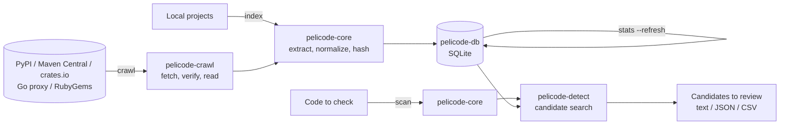

# pelicode Specification

English | [日本語](spec.ja.md)

> Covers: the implementation of pelicode v0.1 (as of 2026-10-17).
> Features not implemented yet are marked as such in the text and listed in [§12](#12-status-and-future-work).

## Contents

1. [Purpose and Positioning](#1-purpose-and-positioning)
2. [Concepts and Terms](#2-concepts-and-terms)
3. [System Overview](#3-system-overview)
4. [Feature Extraction (pelicode-core)](#4-feature-extraction-pelicode-core)
5. [Reference Database (pelicode-db)](#5-reference-database-pelicode-db)
6. [Collection (pelicode-crawl)](#6-collection-pelicode-crawl)
7. [Detection (pelicode-detect)](#7-detection-pelicode-detect)
8. [Interfaces](#8-interfaces)
9. [Non-functional Requirements and Design Principles](#9-non-functional-requirements-and-design-principles)
10. [Development and Delivery](#10-development-and-delivery)
11. [Evaluation](#11-evaluation)
12. [Status and Future Work](#12-status-and-future-work)

---

## 1. Purpose and Positioning

### 1.1 Purpose

Software is no longer written only by its developers. AI assistants generate code, and pull requests arrive from contributors the maintainers have never met. No review can tell, for every line, whether it was copied from somewhere else.

pelicode collects the functions of published packages into a database, checks the functions of the code under development against it, and shows **similar code that should be reviewed**, with its source and license. It applies the idea of dependabot, which checks dependency versions against package repositories, to the code itself.

### 1.2 Positioning

- pelicode does **not** decide whether code is plagiarized or infringes a license. It shows candidates to review; whether code was reused, and whether that is a problem, is for a person to judge.
- The research focus of the project is the **detection method**: a function-level representation of code, the search for candidates, and accuracy and speed as the database grows. Uses such as checking pull requests are applications of it. The usage scenarios are described in [scenario.md](scenario.md).

### 1.3 Research Questions

Can a detection method that extracts structural features of code per function and searches for similar candidates efficiently be more robust to changes such as renamed identifiers than plain text or token matching, while scaling to large collections of code?

Related questions:

- Under which conditions are functions a good unit of comparison, and where do they fall short (very short functions, functions split or merged, code moved around)?
- How large (in tokens) must a function be for matches not to be mere coincidence?
- How do recall, precision, search time and database size change as the database grows?

### 1.4 Scope

| Item | Scope |
| --- | --- |
| Kinds of similarity | Of the usual clone types: Type-1 (differences in layout and comments only), Type-2 (also in identifiers, literals and types), Type-3 (also added, removed or changed statements). Type-4 (same behavior, different syntax) is out of scope |
| Languages | Go, Java, Kotlin, Python, Ruby, Rust (§4.1) |
| Public repositories | PyPI, Maven Central, the Go module proxy, RubyGems, crates.io (§6) |
| Unit of comparison | Functions, including methods, constructors, lambdas, blocks and closures |

---

## 2. Concepts and Terms

| Term | Meaning |
| --- | --- |
| Function (function unit) | The unit of comparison. Each language defines which syntax nodes are functions (§4.1). |
| Normalization | Removing superficial differences such as comments, layout and the names of identifiers. Four levels, N0 to N3 (§4.2). |
| Exact hash | Hash of the whole normalized token sequence of a function, for exact matches. |
| k-gram | k consecutive tokens. |
| Fingerprint | A k-gram hash selected by winnowing. The fingerprint sets of two functions are compared to find partial matches. |
| MinHash / LSH | A summary of a fingerprint set, and the candidate search built on it. |
| Package / version | A named unit of an ecosystem, and one release of it. |
| Occurrence | A place where a stored function was found: a file of a version of a package. |
| Package count (document frequency, df) | The number of packages containing a hash. |
| Common hash | A hash found in many packages, which is no evidence of copying. |
| Candidate | A stored function reported as similar to a checked function: something to review, not a verdict. |

---

## 3. System Overview

### 3.1 Two Roles

pelicode is used in two roles.

1. **Building the reference database**: collect published packages (`crawl`), or register local projects (`index`), and store the features of their functions in an SQLite database; then count how many packages contain each hash (`stats --refresh`).
2. **Checking code**: extract the features of the functions of the code to check (a directory, or a git range), search the database, and report candidates (`scan`).

Both go through the same feature extraction. Matching only works when the reference side and the checking side normalize and hash code in exactly the same way, which the parameters recorded in the database guarantee (§4.4).

### 3.2 Components



| Crate (directory) | Role | Depends on |
| --- | --- | --- |
| pelicode-core (`core`) | Parsing, function extraction, normalization, hashes, fingerprints, MinHash, LSH, file discovery | - |
| pelicode-db (`db`) | Storage in and lookups from SQLite, compatibility checks, package counts per hash | core |
| pelicode-detect (`detect`) | Candidate search and similarity | core, db |
| pelicode-crawl (`crawl`) | Fetching from public repositories, digest verification, reading archives, license identification | core, db |
| pelicode-cli (`cli`) | The `pelicode` command, including the interpretation of git diffs and the output formats | all |

---

## 4. Feature Extraction (pelicode-core)

### 4.1 Function Units

Source code is parsed with Tree-sitter. For each language, a language adapter (`LanguageSpec`) names the node kinds of functions, comments, identifiers, type names, strings and numbers; adding a language means adding an adapter.

| Language | Extensions | Grammar | Function nodes |
| --- | --- | --- | --- |
| Go | `.go` | tree-sitter-go | `function_declaration`, `method_declaration`, `func_literal` |
| Java | `.java` | tree-sitter-java | `method_declaration`, `constructor_declaration`, `compact_constructor_declaration`, `lambda_expression` |
| Kotlin | `.kt`, `.kts` | tree-sitter-kotlin-ng (community-maintained) | `function_declaration`, `secondary_constructor`, `anonymous_function`, `lambda_literal`, `getter`, `setter` |
| Python | `.py` | tree-sitter-python | `function_definition`, `lambda` |
| Ruby | `.rb` | tree-sitter-ruby | `method`, `singleton_method`, `lambda`, `block`, `do_block` |
| Rust | `.rs` | tree-sitter-rust | `function_item`, `closure_expression` (trait method declarations without a body are not functions) |

Extraction rules:

- Nested functions are extracted as functions of their own, as well as the function around them, and the relation is recorded. A function node directly inside another (such as Ruby's `-> { }` and its block) counts as one.
- Functions containing syntax errors are not extracted; the other functions of the file are.
- Function names are for display only and never used for matching. Functions without a name are `<anonymous>`; Kotlin accessors are `get` and `set`, and secondary constructors `constructor`.
- Every function records its lines and columns (1-based) and its byte range (0-based, end exclusive).

### 4.2 Normalization

The syntax tree of a function is walked in pre-order into a token sequence, which gives four representations:

| Level | Content | Differences it absorbs |
| --- | --- | --- |
| N0 | Tokens without comments and whitespace | Layout, comments (Type-1) |
| N1 | N0 with identifiers replaced by `$ID`, strings by `$STR`, numbers by `$NUM` and booleans by `$BOOL`; type names are kept | Renaming, changed literals (Type-2) |
| N2 | N1 with type names replaced by `$TYPE` too | Renamed types |
| N3 | The kinds of the named nodes, in pre-order, without their text | Many token-level edits (part of Type-3) |

Common rules:

- A string literal, interpolations included, is one token; its inside is not looked at.
- In Python, the docstring at the start of a function body is dropped at every level.
- In Go, Kotlin, Python and Ruby, the optional statement terminator `;` is dropped, so that it makes no difference whether a statement ends with `;` or a newline. In Java and Rust, `;` has a syntactic meaning and is kept.
- Type names are the nodes the adapter names as such (`type_identifier` in Java and Go, constants in Ruby, ...) and the identifiers inside a type context (`type` in Python, `user_type` in Kotlin).
- Identifiers are abstracted in one of two ways (`--ident-mode`): `uniform` (default) turns every one into `$ID`; `indexed` numbers them by first appearance in the function, `$ID1`, `$ID2`, ...

The normalization rules carry a version (`NORMALIZER_VERSION`, currently 1). Features of different versions cannot be compared (§4.4).

### 4.3 Features

For each function:

| Feature | How it is computed | Used for |
| --- | --- | --- |
| Size | Number of N0 tokens, number of named nodes, depth of the syntax tree | Leaving out small functions, statistics |
| Exact hash | The first 128 bits of BLAKE3 over the tokens of a level, each followed by a separator (0x1F) | Exact match search (N0 to N2), recorded for N3 |
| k-gram hashes | Each token hashed with xxh3 (64 bits); each run of k token hashes hashed with xxh3 again. A sequence shorter than k gives one k-gram | Input of the fingerprints |
| Fingerprints | Winnowing (window w) over the k-gram hashes: the minimum of every window, the rightmost on ties; each with the source lines its k-gram covers | Comparing partial matches, showing matched lines |
| MinHash | A signature of length n of the fingerprint set; its i-th value is the minimum of splitmix64(h xor splitmix64(i)) over the hashes h | Input of LSH |
| LSH buckets | The MinHash signature cut into b bands of n/b rows, each band hashed with xxh3 seeded with the band number | Candidate search |

Fingerprints, MinHash signatures and LSH buckets are computed only for functions with at least `min_tokens` tokens, at the chosen levels (`--levels`, N1 by default), because short functions match by chance too easily. Exact hashes are recorded for short functions too.

By the property of winnowing, two functions sharing a run of at least w + k − 1 tokens share at least one fingerprint.

### 4.4 Parameters and Compatibility

| Parameter | Option | Default |
| --- | --- | --- |
| Minimum number of tokens | `--min-tokens` | 50 |
| Identifier abstraction | `--ident-mode` | `uniform` |
| k | `--kgram` | 10 |
| Winnowing window w | `--window` | 4 |
| MinHash length n | `--minhash-size` | 128 |
| LSH bands b | `--bands` | 32 (must divide n) |
| Fingerprint levels | `--levels` | N1 |

The normalization version, `ident_mode`, k, w, n and b decide the values of the hashes, so a database records them (`meta`, §5.2).

- Adding to a database with other values is an error.
- `scan` reads the recorded values and computes the features of the checked code with them.
- The default of k was changed from 5 to 10 after a preliminary observation (§11.2).

---

## 5. Reference Database (pelicode-db)

### 5.1 Design Principles

- **No source code is stored.** The database holds hashes, locations (lines and byte ranges), sources (package, version, path, download URL, archive hash) and licenses. If it leaks, nobody's code leaks with it; the original can always be fetched again from its source.
- **Files are identified by their content.** Functions belong to a file content (SHA-256), and files are linked to package versions many-to-many. Files unchanged between versions are stored once.
- **Compatibility is checked.** The version of the table layout (`SCHEMA_VERSION`, currently 5; a version 4 database is upgraded in place) and the feature parameters are recorded, and a database that differs is not opened.
- SQLite (in WAL mode) is used: a single file is easy to distribute and reproduce.

### 5.2 Data Model

| Table | Contents | Main indexes |
| --- | --- | --- |
| `meta` | `schema_version`, `normalizer_version`, `ident_mode`, `kgram`, `window`, `minhash_size`, `bands`, generation numbers of the index and of the statistics, time of the last statistics | key |
| `ecosystem` | Ecosystem name | name |
| `package` | Ecosystem, package name, repository URL | (ecosystem, name) |
| `package_version` | Package, version, publication time, license, download URL, SHA-256 of the archive, crawl time, status (`indexed` / `failed`), error | (package, version) |
| `source_file` | SHA-256 of the content, language, number of functions | content_sha256 |
| `version_file` | Version, file, path within the package (with `/`) | (version, path), file |
| `function` | File, enclosing function, name, node kind, lines, columns and byte range, tokens, nodes, depth | file |
| `exact_hash` | Function, level, exact hash (128 bits) | (level, hash) |
| `fingerprint` | Function, level, hash, token position, lines | (level, hash), (function, level) |
| `minhash` | Function, level, signature | (function, level) |
| `lsh_bucket` | Level, band, bucket, function | (level, band, bucket) |
| `exact_stats` / `fingerprint_stats` | Level, hash, package count, function count (hashes in two or more packages only) | (level, hash) |
| `stats_pending_exact` / `stats_pending_fingerprint` | Level and hash whose package count may have changed since the last statistics | (level, hash) |

### 5.3 Indexing

`index` and `crawl` store one package version at a time, in one transaction:

1. Register the ecosystem, the package and the version (or update them), with the status `indexed`.
2. Remove the files linked to that version, so that indexing a version again replaces its file list.
3. For each file, link the existing file when its SHA-256 is already stored; otherwise store its functions and their features.
4. Increment the index generation, which tells that the statistics are out of date.

A version that could not be fetched or indexed is recorded with the status `failed` and the error.

### 5.4 Package Counts

For each hash, the number of packages containing it (several versions of a package count once) and the number of functions are counted into `exact_stats` and `fingerprint_stats`.

- Only hashes found in two or more packages are stored; a hash without a row counts as one package.
- The counts are refreshed by `stats --refresh`, or `--refresh-stats` of `index` and `crawl`.
- **Incremental refresh**: a package count can only change for the hashes of files linked to or unlinked from a version. Once statistics exist, `index` records the hashes of the files of the version before and after replacing its file list in `stats_pending_exact` and `stats_pending_fingerprint`; a refresh recounts only those hashes over all linked files, and gives the same counts as a full recount. The hashes themselves are recorded, not the files, so that `clean` removing unlinked files does not lose them.
- A full recount is made for the first statistics, for a database upgraded from schema version 4 while its statistics were out of date (the changes since were not recorded), and with `stats --refresh --full`. `meta.stats_pending_complete` tells whether the pending hashes cover every change since the last statistics.
- The index generation at the time of counting is recorded; when the index has changed since, the counts are out of date, and `scan` warns about it.

---

### 5.5 Cleanup

Indexing a version again replaces its file list, which may leave files that no version links to. `pelicode clean` removes them with their functions, exact hashes, fingerprints, MinHash signatures and LSH buckets, in one transaction, then gives the space back with SQLite `VACUUM` (with a checkpoint of the write-ahead log before and after). The hash statistics need no recount, since they count linked files only.

## 6. Collection (pelicode-crawl)

### 6.1 Common Steps

For each package:

1. **Resolve the version**: get the metadata of the requested version, or of the latest release, from the repository's API.
2. **Skip what is indexed**: a version with the status `indexed` is skipped unless `--force` is given.
3. **Fetch and verify**: download the archive and check it against the digest the repository publishes.
4. **Read**: read the files of supported languages and the license files **in memory, without unpacking to disk**. A fixed number of leading path components (such as `name-1.0/` of an sdist) is dropped; entries with absolute paths or `..` are ignored.
5. **Extract and index**: extract the features of the files in parallel, and store them.
6. **Record**: when a step from 3 on fails, record the status `failed` and the error.

Packages are given by name (`NAME[@VERSION]` and the like), in a list file (`--list`), or as the N most downloaded ones (`--top`, PyPI and crates.io only); duplicates are dropped.

### 6.2 Per Repository

| Item | PyPI | Maven Central | Go | RubyGems | crates.io |
| --- | --- | --- | --- | --- | --- |
| Ecosystem name | `pypi` | `maven` | `go` | `rubygems` | `crates` |
| Package syntax | `NAME[@VERSION]` | `GROUP:ARTIFACT[:VERSION]` | `MODULE[@VERSION]` | `NAME[@VERSION]` | `NAME[@VERSION]` |
| Version | JSON API | `release` of `maven-metadata.xml` | `@latest` / `.info` of the module proxy | API v1 / v2 | API (the version shown by default) |
| Archive | sdist, else a wheel | `-sources.jar` | Module zip | `.gem` (its `data.tar.gz`) | `.crate` (static.crates.io) |
| Verification | SHA-256 | `.sha1` | `h1:` (dirhash) from sum.golang.org | SHA-256 | SHA-256 |
| License | `license_expression`, classifiers, `license` | `<licenses>` of the POM (up to 5 parent POMs) | Text of the LICENSE file | `licenses` | `license` (`/` read as `OR`) |
| Publication time | `upload_time_iso_8601` | `Last-Modified` of the sources jar | `Time` of `.info` | `version_created_at` | `created_at` |
| Repository URL | `project_urls` | `<scm><url>` / `<url>` of the POM | `Origin.URL` of `.info` | `source_code_uri` / `homepage_uri` | `repository` |
| Top N | hugovk/top-pypi-packages | none | none | none | All-time downloads |

- PyPI names are normalized as defined by PEP 503.
- Go module paths are escaped as the module proxy requires: an upper-case letter becomes `!` and the lower-case letter.
- A `-sources.jar` of Maven Central may hold both Java and Kotlin; the language is told by the extension.

### 6.3 License Identification

- Common notations (classifiers, license names in POMs) are converted into SPDX identifiers; anything else is recorded as declared.
- When the metadata declares no license (Go modules), the text of the top-level `LICENSE*`, `LICENCE*` and `COPYING*` files is compared with well-known wordings (Apache-2.0, MIT, BSD-2-Clause, BSD-3-Clause, ISC, MPL-2.0, GPL, LGPL, Unlicense); several are joined with `AND`.

### 6.4 Politeness and Limits

- Requests are sent one at a time, at least `--delay-ms` apart (1000 ms by default).
- The User-Agent is `pelicode/<version> (research crawler)` with the contact given by `--contact`, if any. For crates.io, whose data access policy strongly suggests a contact, a missing one is warned about.
- On 429, 5xx and network errors, a request is tried up to four times in all, doubling the wait each time. 404 means "does not exist".
- Limits: 512 MB per archive, 1 GB of source files per archive, 8 MB per file (larger files are likely generated, and skipped).

---

## 7. Detection (pelicode-detect)

### 7.1 What Is Checked

- **Files and directories**: every file of a supported language in them, except hidden files and, in Git repositories, files ignored by `.gitignore`.
- **A git range** (`--git`): with `BASE..HEAD` or `BASE...HEAD` the content of HEAD, with `BASE` alone the working tree, and only the functions overlapping lines added or changed in `git diff --unified=0`. A pure deletion marks the line where it happened.

Files can be narrowed down by language (`--languages`) and by glob patterns over their reported paths (`--exclude-path`, where `*` stays within a directory and `**` crosses directories). Functions with fewer than `--min-tokens` tokens (50 by default) are not checked.

### 7.2 Candidate Search

For each function, candidates are gathered in stages:

1. **Exact matches**: the exact hashes are looked up at N0, N1 and N2, in this order. A function found is an exact match (similarity 1.0) at the first level that matched. A hash whose package count reaches the stop threshold is not used at that level.
2. **LSH**: for each level with fingerprints, the buckets of every band are looked up, and the functions found are candidates.
3. **Similarity**: the fingerprint set of each candidate is loaded and its similarity computed as in §7.3; exact matches are left out. When a function is found at several levels, the most similar is kept.
4. **Occurrences**: the places of each candidate are loaded, earliest publication first, and the excluded packages (`--exclude`) removed; a candidate with no place left is dropped.
5. **Ranking**: candidates are sorted by similarity, and the first `--max-candidates` (5 by default) reported.

### 7.3 Similarity

Let Q be the fingerprint set of the checked function and C that of a candidate, and give each fingerprint h a weight w(h):

- w(h) = 0 when the package count of h reaches the stop threshold (a common hash);
- w(h) = ln(1 + N / df(h)) with `--idf`, where N is the number of packages;
- w(h) = 1 otherwise.

The **similarity** is the weighted Jaccard similarity Σ_{Q∩C} w / Σ_{Q∪C} w, and the **containment** Σ_{Q∩C} w / Σ_Q w. A candidate is not reported when:

- its similarity is below `--threshold` (0.7 by default), or
- it shares fewer than `--min-shared` (5 by default) fingerprints of non-zero weight. Without this, one or two coincidences left after common fingerprints are removed could make a high similarity.

The lines of the shared fingerprints are merged into the matched lines of both functions.

### 7.4 Common Code

Code that appears in many packages independently, such as getters, `equals` methods and boilerplate error handling, is no evidence of copying. Based on the counts of §5.4, hashes whose package count reaches the stop threshold (`--stop-packages`) are ignored, for exact and similar matches alike.

- The threshold is a number of packages (100 by default; 0 disables) or a percentage of all packages (such as `40%`), rounded up and at least 2.
- `scan` warns when the counts were never made or are out of date.

### 7.5 What Is Reported

For each checked function: its file, name, lines and size, and its candidates. For each candidate:

- the kind of match (`exact` / `similar`) and its level, the similarity, the containment and the number of shared fingerprints;
- for exact matches, the number of packages containing the same normalized function;
- the matched lines, in the checked function and in the candidate;
- the stored function (name, node kind, language, lines, byte range, size);
- up to five occurrences (ecosystem, package, version, path, license, publication time, repository URL, download URL, SHA-256 of the file) and their total number.

Reports speak of "similar code candidates to review", never of plagiarism or infringement.

---

## 8. Interfaces

### 8.1 Commands

| Command | Description |
| --- | --- |
| `pelicode crawl <ECOSYSTEM> [PACKAGES]...` | Fetch packages from a public repository and index them (§6) |
| `pelicode index <PATHS>...` | Index local directories as one package version; the ecosystem is `local` by default |
| `pelicode stats` | Show database statistics and the most common hashes; `--refresh` recounts them |
| `pelicode clean` | Remove files and functions no version refers to any more, then shrink the file (`--dry-run` only counts them) |
| `pelicode scan [PATHS]...` | Search for candidates (§7) |
| `pelicode extract <PATHS>...` | Show functions and their features, without a database |
| `pelicode export` | List the functions stored in a database |
| `pelicode languages` | Show the supported languages and extensions |

All options and examples are in [Usage](https://tamada.github.io/pelicode/usage/) on the documentation site.

### 8.2 Settings File

Options used every time can be written in a settings file, in YAML or JSON5.

- **Names**: `.pelicode.yaml`, `.pelicode.yml`, `.pelicode.json5` and `.pelicode.json` (read as JSON5).
- **Discovery**: the current directory, then each directory above it, up to the root of the git repository (the directory holding `.git`). Several files in one directory are an error. `--config <FILE>` names a file, and `--no-config` disables settings files; both are accepted by every command.
- **Precedence**: command line, then settings file, then built-in defaults. Lists (`--exclude`, `--exclude-path`) are merged with those of the file. Flags (`--idf`, `--fail-on-match`) can only switch a setting on.
- **Keys**: `version` (must be 1), `database` (relative to the settings file), `scan.languages`, `scan.threshold`, `scan.min_tokens`, `scan.max_candidates`, `scan.min_shared`, `scan.stop_packages` (a number, or a percentage such as `"10%"`), `scan.idf`, `scan.fail_on_match`, `scan.exclude.packages`, `scan.exclude.paths`, `crawl.contact` and `crawl.delay_ms`. Each corresponds to the option of the same name.
- **Validation**: unknown keys, an unsupported version, a threshold outside 0 to 1, invalid stop thresholds, package names and glob patterns are errors, reported with the file (and, for YAML, the line).
- **Implementation**: YAML is read with serde-saphyr and JSON5 with json5, into the same serde types.

```yaml
version: 1
database: data/pelicode.db
scan:
  languages: [python, rust]
  threshold: 0.6
  stop_packages: 10%
  exclude:
    packages: ["local:my-project"]
    paths: ["vendor/**"]
crawl:
  contact: https://example.org/about
```

### 8.3 GitHub Action

The repository is a composite GitHub Action (`action.yml`) for checking pull requests:

1. **Install**: the release of the action's tag (`uses: tamada/pelicode@vX.Y.Z`), downloaded from the releases of the repository for the runner's platform; at other refs, the action's own source built with Cargo; or a binary given by `pelicode-path`.
2. **Database**: downloaded from `database-url`, if given; otherwise `database`, the settings file, or `pelicode.db`.
3. **Scan**: `pelicode scan -f sarif` over `base...head` of a pull request, `before..after` of a push, or the whole repository for other events and for pushes creating a branch; `range`, `paths`, `config` and `args` override this.
4. **Report**: the number of functions with candidates as the output `candidates`, the candidates in the summary of the job, and the SARIF log uploaded to code scanning (`github/codeql-action/upload-sarif`, category `pelicode`) unless `upload-sarif` is `false`.
5. **Fail**: only with `fail-on-match`, after the upload, so that the notes appear. A `fail_on_match` in the settings file does not stop the action before the upload.

The logic is in `action/install.sh` and `action/scan.sh`, and a workflow (`test_action`) runs the action on a repository with a copied function and checks its outputs.

### 8.4 Output Formats

| Command | text | JSON | CSV |
| --- | --- | --- | --- |
| `scan` | Each function with its candidates | Array of reports (all of §7.5) | One row per candidate |

`scan` also writes SARIF 2.1.0 (`-f sarif`), for GitHub code scanning: one result per checked function with candidates, at the level `note`, with the rule `exact-match` or `similar-match` after its best candidate, a message naming the candidate, its source, license and matched lines, all candidates in `properties`, and `partialFingerprints` to track an alert across runs. Paths are relative to the current directory, normally the root of the repository.
| `extract` | One line per function (tokens with `--tokens`) | All features, per file | One row per function |
| `export` | One line per occurrence | All fields, per occurrence | One row per occurrence |
| `index`, `stats` | Summary | Summary | - |

Paths are recorded and printed with `/` on every platform.

### 8.5 Exit Status

| Status | Meaning |
| --- | --- |
| 0 | Success |
| 1 | An error; `crawl` failed for a package; or `scan --fail-on-match` found a candidate |

### 8.6 Libraries

pelicode-core, pelicode-db, pelicode-detect and pelicode-crawl can be used as libraries. Every public item is documented, and every public function has an example (doctest).

---

## 9. Non-functional Requirements and Design Principles

| Item | Requirement |
| --- | --- |
| No verdicts | Results are candidates to review; people decide. |
| No source code kept | The database holds no source code, and archives are not unpacked to disk (§5.1, §6.1). |
| Provenance | Every candidate names its package, version, file, lines, license and source. |
| Local checks | With a database at hand, checks run locally or in CI, and the checked code is never sent anywhere. |
| Reproducibility | The feature parameters and the version of the rules are recorded, and different ones are never mixed (§4.4). |
| Politeness | Paced requests, retries, contact information, and the policies of each service (§6.4). |
| Safety | Downloaded archives are verified against their digests, entries with unsafe paths are ignored, and sizes are limited. |
| Portability | Linux, macOS and Windows, on x64 and arm64; paths use `/`. |
| Extensibility | A language is added with a language adapter, a repository with an adapter (`resolve` and `parse_release`). |

---

## 10. Development and Delivery

- **Build and test**: Rust 1.90 or later. The tasks are in the Justfile (`just test`, `just clippy`, `just doc`, `just publish_check`, `just docker`). Tests do not access the network.
- **CI** (GitHub Actions): formatting, clippy, build and tests on Linux, macOS and Windows (x64 and arm64), coverage (Coveralls), SonarQube.
- **Release**: the version is bumped on a `release/vX.Y.Z` branch; merging it into main publishes binaries for six platforms, a container image (`quay.io/tama5/pelicode`, amd64 and arm64) and the crates on crates.io, after which the Homebrew formula (`tamada/tap/pelicode`) is updated.
- **Container**: carries git and CA certificates, and runs as an unprivileged user in `/workdir`.
- **Documentation**: READMEs (English and Japanese), usage scenarios, this specification, a Hugo documentation site on GitHub Pages, and API documentation.
- The license is MIT.

---

## 11. Evaluation

### 11.1 Evaluation Plan (not done yet)

**Data**

- Mutated code: functions of the reference corpus with changed whitespace and comments, consistently renamed identifiers, changed literals, inserted, removed or reordered statements (at increasing rates), functions split or merged, partial reuse, and rewrites by an LLM.
- Existing benchmarks: BigCloneBench (Java) and others.
- Negatives: independent implementations not in the reference corpus, to measure false matches by coincidence.

**Metrics**: recall, precision and F-measure (per kind and strength of mutation, and per function size); search time (per function and per pull request); index build time and size; the reduction of candidates by LSH; and how these change as the database grows from 10^4 to 10^7 functions.

**Baselines**: exact text and line matching, token n-grams without normalization, existing clone detectors (NiCad, SourcererCC, ...) and plagiarism detectors (JPlag, ...).

A command that runs evaluation experiments (`pelicode eval`) is not implemented yet.

### 11.2 Preliminary Observations

**k and the exclusion of common hashes**: with the 25 most downloaded PyPI packages (about 77,000 functions) as the database, the Python standard library packages `json`, `http` and `email`, which are not in it, and a renamed copy of `requests.utils.super_len` were checked at a threshold of 0.5.

| k | Excluded | Similarity of the copy | Coincidental matches |
| --- | --- | --- | --- |
| 5 | none | 0.82 | 5 |
| 5 | in 20%+ | not found | 0 |
| 5 | in 40%+ | 0.77 | 1 |
| 10 | none | 0.72 | 2 |
| 10 | in 20%+ | 0.66 | 1 |
| 10 | in 40%+ | 0.67 | 0 |

- N1 5-grams have only about 58,000 distinct values and hardly discriminate: 48 of the 60 fingerprints of `super_len` appear in 10 packages or more, so excluding common fingerprints also removed the evidence of the copy. With k=10 there are about 420,000 distinct values, and the copy is still found after exclusion. The default of k became 10.
- Of the remaining coincidental matches, `_tunnel` of `http.client` is overridden by urllib3 in a subclass of the same class, and probably shares its origin.
- At this size (N=25), IDF weighting made little difference.
- At first, after common fingerprints were removed, a single remaining shared fingerprint could give a similarity of 1.0; `--min-shared` was introduced for this.

**Checking pelicode itself**: with the crates pelicode depends on and the 30 most downloaded crates (48 crates, about 40,000 functions) as the database, the 457 Rust functions of pelicode were checked. With the default settings there were no candidates; at a threshold of 0.3, only boilerplate `match` expressions of `FromStr::from_str` were weakly similar (about 0.4). A function of httpdate copied with renamed identifiers and without comments was found as an exact N1 match.

---

## 12. Status and Future Work

### 12.1 Status

| Feature | Status |
| --- | --- |
| Function extraction for six languages, normalization N0 to N3 | Done |
| Exact hashes, fingerprints, MinHash, LSH | Done |
| SQLite database (deduplication by content, compatibility checks) | Done |
| Collection from five public repositories, with verification | Done |
| Package counts (incremental refresh), exclusion of common hashes, IDF | Done |
| Checking directories and git ranges; text, JSON and CSV | Done |
| Settings files in YAML and JSON5 | Done |
| SARIF output | Done |
| GitHub Action for pull requests | Done |
| Database cleanup (`pelicode clean`) | Done |
| CI, release, container, documentation site | Done (no release made yet) |

### 12.2 Not Implemented Yet

| Feature | Description |
| --- | --- |
| Detection of new versions | `list_updates(since)` with the RSS feeds of crates.io, PyPI updates, index.golang.org, ... |
| Snapshots | Creating (`pelicode snapshot`) and distributing databases without source code |
| Evaluation | `pelicode eval` and the generation of evaluation data (§11.1) |
| No dependency on the git command | Reading diffs with gix, the Rust implementation of git |

### 12.3 Open Questions

| Question | Description |
| --- | --- |
| Default parameters | k, w, `min_tokens`, the stop threshold and the similarity threshold, to be decided by an evaluation at a larger scale. |
| Default levels | Whether to compute fingerprints at N2 or N3 as well as N1, and whether to keep the names of built-in APIs out of the abstraction. |
| Unit of comparison | Whether to add units below functions (blocks, subtrees) or above them (classes, files); subtree hashes for partial reuse. |
| Scale | About 200 MB for 25 packages. Size, counting time and search time for thousands of packages and more; PostgreSQL or a key-value store if needed. |
| Distribution | GitHub Releases, an OCI registry, or a server of its own. |
| Dependencies | Whether matches with the packages the checked code depends on (from its lock files) should be excluded by default. |
| More languages | JavaScript/TypeScript (minified code), C/C++ (preprocessor), C# (NuGet packages without sources). |
