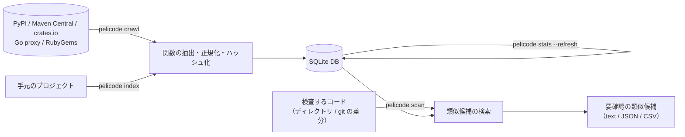

# pelicode

[English](README.md) | 日本語

関数単位でコードの構造的な特徴（AST に基づくハッシュ）を取り出し、公開パッケージのコードと照らし合わせて、**確認が必要な類似コードの候補**を見つけるツールです。

dependabot が依存ライブラリのバージョンを外部リポジトリと照合するように、pelicode はコミットや PR に含まれる関数を、crates.io や PyPI などで公開されているコードと照合します。AI が生成したコードや外部からの PR に、開発者の知らないうちに他所のコードが紛れ込んでいないかを調べる手がかりにします。

> [!IMPORTANT]
> pelicode は盗用やライセンス違反を**判定しません**。示すのは、出典とライセンスを添えた「要確認の類似候補」です。流用かどうか、ライセンス上の問題があるかどうかは、人が確認して判断してください。

研究用の試作（v0.1）です。想定している使い方と現状は [利用シナリオ](.github/docs/scenario.ja.md) に、設計と実装の詳細は [仕様書](.github/docs/spec.ja.md) にあります。

## 仕組み



1. **関数の抽出**: [Tree-sitter](https://tree-sitter.github.io/) で構文解析し、関数・メソッド・ラムダなどを1つずつ取り出します。
2. **正規化**: 表面的な違いを消すため、段階的に抽象化します。
   - N0: 空白とコメントを除く
   - N1: 識別子を `$ID`、リテラルを `$STR` や `$NUM` に置き換える
   - N2: さらに型名を `$TYPE` に置き換える
   - N3: AST のノードの種類だけを並べる
3. **ハッシュ化**: 関数全体のハッシュ（完全一致用）と、トークン列の k-gram から winnowing で選んだフィンガープリント（部分一致用）を計算します。後者からは MinHash と LSH のバケットも作ります。
4. **検索**: 完全一致（N0 → N1 → N2 の順）を探したあと、LSH で候補を絞ります。絞った候補はフィンガープリント集合の Jaccard 係数で比べます。
5. **ありふれたコードの除外**: 多くのパッケージに現れるハッシュ（getter、`equals`、定型処理など）は流用の証拠にならないので、検索時に除外したり重みを下げたりできます。

ソースコードそのものは DB に保存しません。保存するのはハッシュ、位置（行・バイト範囲）、出典（パッケージ・バージョン・パス・取得元 URL）、ライセンスだけです。

## 対応状況

| 言語 | 拡張子 | Tree-sitter の文法 |
| --- | --- | --- |
| Go | `.go` | tree-sitter-go |
| Java | `.java` | tree-sitter-java |
| Kotlin | `.kt`, `.kts` | tree-sitter-kotlin-ng（コミュニティ製） |
| Python | `.py` | tree-sitter-python |
| Ruby | `.rb` | tree-sitter-ruby |
| Rust | `.rs` | tree-sitter-rust |

| エコシステム | 取得するもの | 改ざん検査 |
| --- | --- | --- |
| PyPI | sdist（なければ wheel） | SHA-256 |
| Maven Central | `-sources.jar`（Java と Kotlin） | SHA-1 |
| Go | モジュールの zip | sum.golang.org の `h1:` ハッシュ |
| RubyGems | `.gem` | SHA-256 |
| crates.io | `.crate` | SHA-256 |

## インストール

Homebrew、Cargo、Docker、ソースからの4通りがあります（Cargo とソースからの場合は Rust 1.90 以降が必要です）。

```bash
brew install tamada/tap/pelicode
cargo install pelicode-cli
docker run --rm -v "$PWD":/workdir quay.io/tama5/pelicode --help
```

Homebrew の Formula、crates.io の crate、コンテナイメージは、最初のリリースと一緒に公開します。それまではソースからビルドしてください。

```bash
cargo install --path cli
```

`pelicode` コマンドが `~/.cargo/bin` に入ります。インストールせずに試す場合は、`pelicode` の代わりに `cargo run --release --` を使ってください。詳しくは[インストールガイド](https://tamada.github.io/pelicode/install/)（英語）を見てください。

## クイックスタート

```bash
# 1. 公開パッケージを取得して DB（pelicode.db）に索引する
pelicode crawl pypi requests six
pelicode crawl maven org.apache.commons:commons-lang3
pelicode crawl go github.com/google/uuid
pelicode crawl rubygems rack

# 2. ハッシュごとの出現パッケージ数を集計する
pelicode stats --refresh

# 3. 手元のコードを検査する
pelicode scan ./src
```

検査の結果は次のように表示されます。

```
1 function(s) have similar code candidates to review.

hex.go:10-44 parseID (tokens=275)
  similar(N1)  0.81  go:github.com/google/uuid@v1.6.0 uuid.go:68-117 [BSD-3-Clause]
               lines 12-44 <-> 70-108,110-117 (containment 0.89, 80 shared fingerprints)
```

1行目は検査した関数の位置と名前です。続く行が候補で、一致の種類（`exact(N1)` なら N1 で完全一致、`similar(N1)` なら N1 で類似）、類似度、出典、ライセンスを示します。その下の `lines` は、一致した部分が両方のコードのどの行にあるかです。

## コマンド

| コマンド | 内容 |
| --- | --- |
| `pelicode crawl <ECOSYSTEM> [PACKAGES]...` | 公開リポジトリからパッケージを取得して索引する |
| `pelicode index <PATHS>...` | 手元のディレクトリを1つのパッケージとして索引する |
| `pelicode stats` | DB の統計と、多くのパッケージに現れるハッシュを表示する |
| `pelicode clean` | 参照されなくなったデータを削除し、DB を縮める |
| `pelicode snapshot -o <FILE>` | 配布用に、検査専用の DB のコピーを書き出す |
| `pelicode scan [PATHS]...` | 類似候補を検索する |
| `pelicode extract <PATHS>...` | 関数の抽出結果と特徴量を表示する（DB は使わない） |
| `pelicode export` | DB に入っている関数を一覧する |
| `pelicode languages` | 対応言語と拡張子を表示する |

どのコマンドも `--db <FILE>` で DB を指定できます（既定は `pelicode.db`）。オプションの一覧は `pelicode <COMMAND> --help` で確認できます。

### crawl: 公開パッケージの取得

```bash
pelicode crawl pypi requests numpy@2.1.0         # NAME[@VERSION]
pelicode crawl pypi --top 100                    # ダウンロード数の上位 100 件（PyPI と crates.io のみ）
pelicode crawl maven com.google.code.gson:gson:2.11.0
pelicode crawl go golang.org/x/mod@v0.20.0
pelicode crawl rubygems thor@1.3.0
pelicode crawl crates uuid serde_json@1.0.140 --contact https://example.org/about
pelicode crawl maven --list packages.txt         # 1行に1パッケージ（# 以降はコメント）
```

- バージョンを省くと最新版を取得します。
- 取得済みのバージョンは飛ばします。取り直すときは `--force` を付けます。
- アーカイブはディスクに展開せず、メモリ上で読んで捨てます。
- リクエストは1件ずつ、既定で1秒の間隔を空けて送ります（`--delay-ms`）。大量に取得するときは、`--contact` で連絡先（URL かメールアドレス）を User-Agent に入れてください。
- 失敗したパッケージは DB に記録されます。1件でも失敗すると終了コードは 1 です。
- PyPI の `--top` が使うダウンロード数のランキングは、PyPI 公式ではなく第三者の [hugovk/top-pypi-packages](https://github.com/hugovk/top-pypi-packages) です。crates.io では、crates.io 自身の累計ダウンロード数を使います。
- [crates.io のデータアクセスポリシー](https://crates.io/data-access)は、API へのリクエストを1秒に1回までとし、連絡先の明示を強く推奨しています。crates.io から取得するときは `--contact` を付け、`--delay-ms` は 1000 以上にしてください。

### index: 手元のプロジェクトの登録

```bash
pelicode index ./my-project --name my-project --version 1.0 --license MIT
```

エコシステムは既定で `local` です。複数のディレクトリを渡すと、ファイルのパスの先頭にディレクトリ名が付きます。

### stats: ありふれたハッシュの集計

```bash
pelicode stats --refresh          # 集計し直してから表示する
pelicode stats --top 20 -f json
```

集計は自動では更新されません。`crawl` や `index` で追加したあとは、`--refresh` を付けて実行するか、`crawl` / `index` に `--refresh-stats` を付けてください。集計が古いまま `scan` すると警告が出ます。2回目以降の集計では、前回から索引されたもののハッシュだけを数え直します。結果は全体を数え直した場合（`--refresh --full`）と同じです。

### scan: 類似候補の検索

```bash
pelicode scan ./src
pelicode scan --git main..HEAD                   # main から HEAD までに変更された関数だけ
pelicode scan --git HEAD                         # 作業ツリーの未コミットの変更だけ
pelicode scan ./src -f json -o report.json
pelicode scan ./src -f sarif -o pelicode.sarif    # SARIF（GitHub Code Scanning 向け）
pelicode scan ./src --exclude local:my-project   # 自分自身のパッケージは除く
pelicode scan ./src --fail-on-match              # 候補があれば終了コード 1（CI 向け）
```

主なオプションは次のとおりです。

| オプション | 既定値 | 意味 |
| --- | --- | --- |
| `--threshold` | 0.7 | 報告する類似度の下限 |
| `--min-tokens` | 50 | これより短い関数は検査しない（短い関数は偶然一致しやすいため） |
| `--max-candidates` | 5 | 1関数あたりの候補数の上限 |
| `--stop-packages N` または `P%` | 100 | N 個以上（または全体の P% 以上）のパッケージに現れるハッシュを無視する。0 で無効 |
| `--min-shared` | 5 | 類似一致とみなすのに必要な共有フィンガープリント数 |
| `--idf` | 無効 | フィンガープリントを `ln(1 + N / df)` で重み付けする |

`--stop-packages` の既定値 100 は、大規模な DB を前提にしています。パッケージが数十件しかない DB では効かないので、`--stop-packages 40%` のように割合で指定してください。

`--languages python,rust` で検査する言語を絞り、`--exclude-path 'vendor/**'` でパスを指定してファイルを除外できます。検査するコードが依存しているパッケージ（`Cargo.lock`、`go.mod`、`requirements*.txt`、`poetry.lock`、`uv.lock`、`Pipfile.lock`、`Gemfile.lock`、`pom.xml`、`gradle.lockfile` から読み取ります）にしか出現しない候補は報告しません。`--no-exclude-dependencies` を付けると、それらも報告します。

### 設定ファイル

毎回使うオプションは、リポジトリのルートの `.pelicode.yaml`（または `.pelicode.yml`、`.pelicode.json5`、`.pelicode.json`）に書いておけます。JSON5 でも書けます。

```yaml
# .pelicode.yaml
version: 1
database: data/pelicode.db        # この設定ファイルからの相対パス
scan:
  languages: [python, rust]
  threshold: 0.6
  stop_packages: 10%
  fail_on_match: true
  exclude:
    packages: ["local:my-project"]
    paths: ["vendor/**", "**/testdata/**"]
crawl:
  contact: https://example.org/about
```

pelicode はカレントディレクトリから上に向かって、git リポジトリのルートまで設定ファイルを探します。コマンドラインで指定したオプションは、設定ファイルより優先されます。`--config FILE` で別のファイルを指定でき、`--no-config` で設定ファイルを無視できます。書ける項目の一覧は [Usage](https://tamada.github.io/pelicode/usage/#-settings-file)（英語）を見てください。

### GitHub Action

このリポジトリは、PR を検査して、候補を Code Scanning で表示する GitHub Action としても使えます。

```yaml
# .github/workflows/pelicode.yaml
name: pelicode
on: pull_request

permissions:
  contents: read
  security-events: write   # Code Scanning に結果をアップロードするため

jobs:
  pelicode:
    runs-on: ubuntu-latest
    steps:
      - uses: actions/checkout@v7
        with:
          fetch-depth: 0       # PR と base を比べるため
      - uses: tamada/pelicode@v0.1.0
        with:
          database-url: https://example.org/pelicode/pelicode.db
```

入力の一覧は [Usage](https://tamada.github.io/pelicode/usage/#-github-action)（英語）を見てください。

### extract / export: 中身の確認

```bash
pelicode extract Foo.java --tokens N1     # N1 に正規化したトークン列も表示する
pelicode extract ./src -f csv -o functions.csv
pelicode export -f json
```

## 特徴量のパラメータ

`crawl`、`index`、`extract` で指定できます。

| オプション | 既定値 | 意味 |
| --- | --- | --- |
| `--kgram` | 10 | フィンガープリントにする k-gram の長さ |
| `--window` | 4 | winnowing の窓幅 |
| `--minhash-size` | 128 | MinHash の長さ |
| `--bands` | 32 | LSH のバンド数（`minhash-size` を割り切れる値） |
| `--levels` | N1 | フィンガープリントを計算する正規化レベル（`N1,N2` のように複数指定可） |
| `--ident-mode` | uniform | 識別子をすべて `$ID` にする（`uniform`）か、出現順に `$ID1`, `$ID2`, … と番号を振る（`indexed`） |
| `--min-tokens` | 50 | これより短い関数は完全一致のハッシュだけを保存する |

DB には作成時のパラメータが記録されます。異なるパラメータで同じ DB に追加しようとするとエラーになります。`scan` は DB に記録されたパラメータを自動で使います。

## 構成

| ディレクトリ | crate | 内容 |
| --- | --- | --- |
| [core](core) | pelicode-core | 構文解析、関数抽出、正規化、ハッシュ・フィンガープリント・MinHash |
| [db](db) | pelicode-db | SQLite への保存、検索用の問い合わせ、ハッシュの集計 |
| [detect](detect) | pelicode-detect | 類似候補の検索 |
| [crawl](crawl) | pelicode-crawl | PyPI・Maven Central・Go・RubyGems・crates.io からの取得 |
| [cli](cli) | pelicode-cli | `pelicode` コマンド |

```bash
cargo test       # テスト（ネットワークには接続しません）
cargo clippy --all-targets
just --list      # CI が実行するタスクの一覧（https://just.systems/ を使います）
```

開発の進め方、言語やパッケージリポジトリの追加方法、ハッシュと DB のバージョンを上げる条件は [CONTRIBUTING.ja.md](CONTRIBUTING.ja.md) を参照してください。

## 未実装のもの

- 新しく公開されたバージョンの自動検知（現状は、パッケージ名・一覧ファイル・上位 N 件で指定します）
- 公開済みスナップショットの `scan` や GitHub Action からの取得と、評価実験用のコマンド（`pelicode eval`）
- Go・Maven・RubyGems のダウンロード数上位の取得

## ライセンス

[MIT](LICENSE)
