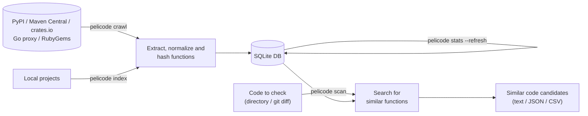

# pelicode

English | [日本語](.github/docs/README.ja.md)

pelicode extracts structural features of code at the function level (hashes based on the AST) and compares them with the code of published packages to find **similar code that should be reviewed**.

Just as dependabot checks dependency versions against external repositories, pelicode checks the functions in your commits and pull requests against code published on repositories such as PyPI, Maven Central and crates.io. It helps you notice code from elsewhere that may have slipped in without the developers knowing, for example through AI-generated code or pull requests from outside contributors.

> [!IMPORTANT]
> pelicode does **not** decide whether code is plagiarized or violates a license. It shows "similar code candidates to review", together with their sources and licenses. Whether code was reused, and whether that raises a license issue, is for a person to check and decide.

This is a research prototype (v0.1). The [usage scenarios](.github/docs/scenario.md) describe who pelicode is for and what works today, and the [specification](.github/docs/spec.md) describes the design and the implementation.

## How it works



1. **Function extraction**: source files are parsed with [Tree-sitter](https://tree-sitter.github.io/), and functions, methods, lambdas and the like are extracted one by one.
2. **Normalization**: superficial differences are removed step by step.
   - N0: whitespace and comments removed
   - N1: identifiers replaced with `$ID`, literals with `$STR`, `$NUM` and so on
   - N2: type names also replaced with `$TYPE`
   - N3: only the kinds of the AST nodes
3. **Hashing**: pelicode computes a hash of the whole function (for exact matches) and fingerprints selected by winnowing from the k-grams of the token sequence (for partial matches). MinHash signatures and LSH buckets are built from the fingerprints.
4. **Search**: exact matches are looked up first (N0, then N1, then N2). LSH then narrows down the candidates, which are compared by the Jaccard similarity of their fingerprint sets.
5. **Filtering common code**: hashes found in many packages (getters, `equals`, boilerplate) are no evidence of copying, so they can be ignored or down-weighted during the search.

The database never stores source code. It stores only hashes, locations (lines and byte ranges), sources (package, version, path, download URL) and licenses.

## Supported languages and repositories

| Language | Extensions | Tree-sitter grammar |
| --- | --- | --- |
| Go | `.go` | tree-sitter-go |
| Java | `.java` | tree-sitter-java |
| Kotlin | `.kt`, `.kts` | tree-sitter-kotlin-ng (community-maintained) |
| Python | `.py` | tree-sitter-python |
| Ruby | `.rb` | tree-sitter-ruby |
| Rust | `.rs` | tree-sitter-rust |

| Repository | What is fetched | Integrity check |
| --- | --- | --- |
| PyPI | sdist (or a wheel when there is none) | SHA-256 |
| Maven Central | `-sources.jar` (Java and Kotlin) | SHA-1 |
| Go | module zip | `h1:` hash from sum.golang.org |
| RubyGems | `.gem` | SHA-256 |
| crates.io | `.crate` | SHA-256 |

## Installation

With Homebrew, Cargo, Docker, or from source (Rust 1.90 or later is required for Cargo and the source):

```bash
brew install tamada/tap/pelicode
cargo install pelicode
docker run --rm -v "$PWD":/workdir quay.io/tama5/pelicode --help
```

Archives for Linux, macOS and Windows (x64 and arm64) are attached to each [release](https://github.com/tamada/pelicode/releases). To build from source:

```bash
cargo install --path cli
```

This installs the `pelicode` command into `~/.cargo/bin`. To try it without installing, use `cargo run --release --` in place of `pelicode`. See the [installation guide](https://tamada.github.io/pelicode/install/) for details.

## Quick start

```bash
# 1. Fetch published packages and index them into the database (pelicode.db)
pelicode crawl pypi requests six
pelicode crawl maven org.apache.commons:commons-lang3
pelicode crawl go github.com/google/uuid
pelicode crawl rubygems rack

# 2. Count how many packages contain each hash
pelicode stats --refresh

# 3. Check your code
pelicode scan ./src
```

The result looks like this:

```
1 function(s) have similar code candidates to review.

hex.go:10-44 parseID (tokens=275)
  similar(N1)  0.81  go:github.com/google/uuid@v1.6.0 uuid.go:68-117 [BSD-3-Clause]
               lines 12-44 <-> 70-108,110-117 (containment 0.89, 80 shared fingerprints)
```

The first line is the location and name of the checked function. Each following line is a candidate: the kind of match (`exact(N1)` for an exact match after N1 normalization, `similar(N1)` for a similar one), the similarity, the source and the license. The `lines` line shows where the matching parts are in both pieces of code.

## Commands

| Command | Description |
| --- | --- |
| `pelicode crawl <ECOSYSTEM> [PACKAGES]...` | Fetch packages from a public repository and index them |
| `pelicode index <PATHS>...` | Index local directories as one package |
| `pelicode stats` | Show database statistics and the hashes found in the most packages |
| `pelicode clean` | Remove data no longer referenced, and shrink the database |
| `pelicode snapshot -o <FILE>` | Write a copy of the database for checking only, to distribute |
| `pelicode pull <oci://...>` | Fetch a snapshot from a registry into the cache (`scan --db oci://...` does it too) |
| `pelicode scan [PATHS]...` | Search for similar code candidates |
| `pelicode extract <PATHS>...` | Show extracted functions and their features (no database) |
| `pelicode export` | List the functions stored in the database |
| `pelicode languages` | Show the supported languages and extensions |

Every command that uses a database takes `--db <FILE>` (default: `pelicode.db`); `scan` takes several, such as `--db pypi.db --db crates.db`. Run `pelicode <COMMAND> --help` for all options.

### crawl: fetching published packages

```bash
pelicode crawl pypi requests numpy@2.1.0         # NAME[@VERSION]
pelicode crawl pypi --top 100                    # the 100 best-known packages
pelicode crawl maven com.google.code.gson:gson:2.11.0
pelicode crawl go golang.org/x/mod@v0.20.0
pelicode crawl rubygems thor@1.3.0
pelicode crawl crates uuid serde_json@1.0.140 --contact https://example.org/about
pelicode crawl maven --list packages.txt         # one package per line; '#' starts a comment
pelicode crawl pypi --updates                    # new versions of the PyPI packages already in the database
```

- Without a version, the latest release is fetched.
- Versions already in the database are skipped. Use `--force` to fetch them again.
- Archives are read in memory and discarded; nothing is unpacked to disk.
- Requests are sent one at a time, by default at least one second apart (`--delay-ms`). When crawling many packages, put a contact URL or e-mail address in the User-Agent with `--contact`.
- Failures are recorded in the database. If any package fails, the exit status is 1.
- For PyPI, the download ranking used by `--top` is not an official PyPI service but [hugovk/top-pypi-packages](https://github.com/hugovk/top-pypi-packages). For crates.io, it is the all-time download count of crates.io. Maven Central, the Go module proxy and RubyGems publish no ranking of their own, so `--top` asks [ecosyste.ms](https://ecosyste.ms/) for them: RubyGems by downloads, Maven Central and Go, which publish no download counts, by the number of repositories that depend on a package. The aim is well-known packages, not one ranking across repositories.
- The [crates.io data access policy](https://crates.io/data-access) allows at most one API request per second and strongly suggests a way to contact you; give `--contact` and keep `--delay-ms` at 1000 or more when crawling crates.io.

### index: registering a local project

```bash
pelicode index ./my-project --name my-project --version 1.0 --license MIT
```

The ecosystem is `local` by default. When several directories are given, file paths are prefixed with the directory names.

### stats: counting common hashes

```bash
pelicode stats --refresh          # recount, then show
pelicode stats --top 20 -f json
```

The counts are not updated automatically. After `crawl` or `index`, run `pelicode stats --refresh`, or pass `--refresh-stats` to `crawl` or `index`. `scan` warns when the counts are out of date. After the first count, a refresh recounts only the hashes of what was indexed since, with the same result as recounting everything (`--refresh --full`).

### scan: searching for similar code

```bash
pelicode scan ./src
pelicode scan --git main..HEAD                   # only functions changed between main and HEAD
pelicode scan --git HEAD                         # only uncommitted changes in the working tree
pelicode scan --staged                           # only staged changes (for a pre-commit hook)
pelicode scan ./src -f json -o report.json
pelicode scan ./src -f sarif -o pelicode.sarif    # SARIF, for GitHub code scanning
pelicode scan ./src --exclude local:my-project   # skip your own package
pelicode scan ./src --fail-on-match              # exit with status 1 when there are candidates (for CI)
```

Main options:

| Option | Default | Meaning |
| --- | --- | --- |
| `--threshold` | 0.7 | Minimum similarity to report |
| `--min-tokens` | 50 | Shorter functions are not checked (they match by chance too easily) |
| `--max-candidates` | 5 | Maximum number of candidates per function |
| `--stop-packages N` or `P%` | 100 | Ignore hashes found in at least N packages (or P% of all packages); 0 disables |
| `--min-shared` | 5 | Number of shared fingerprints required for a similar match |
| `--idf` | off | Weight fingerprints by `ln(1 + N / df)` |

The default `--stop-packages 100` assumes a large database. With only a few dozen packages it has no effect, so give a percentage such as `--stop-packages 40%`.

`--languages python,rust` checks only some languages, and `--exclude-path 'vendor/**'` leaves out files by path. Candidates found only in the dependencies of the checked code (read from `Cargo.lock`, `go.mod`, `requirements*.txt`, `poetry.lock`, `uv.lock`, `Pipfile.lock`, `Gemfile.lock`, `pom.xml` and `gradle.lockfile`) are left out; `--no-exclude-dependencies` reports them too.

### Settings file

Options used every time can be written in `.pelicode.yaml` (or `.pelicode.yml`, `.pelicode.json5`, `.pelicode.json`) at the root of the repository:

```yaml
# .pelicode.yaml
version: 1
database: data/pelicode.db        # relative to this file
scan:
  languages: [python, rust]
  threshold: 0.6
  stop_packages: 10%
  fail_on_match: true
  exclude:
    packages: ["local:my-project"]
    paths: ["vendor/**", "**/testdata/**"]
crawl:
  contact: https://example.org/about
```

pelicode looks for it in the current directory and above, up to the root of the git repository. Options on the command line win over it; `--config FILE` names another file and `--no-config` ignores it. See [Usage](https://tamada.github.io/pelicode/usage/#-settings-file) for every key.

### GitHub Action

[pelicode-action](https://github.com/tamada/pelicode-action) is a GitHub Action that checks pull requests and shows the candidates through code scanning:

```yaml
# .github/workflows/pelicode.yaml
name: pelicode
on: pull_request

permissions:
  contents: read
  security-events: write   # to upload the results to code scanning

jobs:
  pelicode:
    runs-on: ubuntu-latest
    steps:
      - uses: actions/checkout@v7
        with:
          fetch-depth: 0       # pelicode compares the pull request with its base
      - uses: tamada/pelicode-action@v0.1.0
        with:
          database-url: https://example.org/pelicode/pelicode.db
```

See [pelicode-action](https://github.com/tamada/pelicode-action) for its inputs.

### extract / export: looking inside

```bash
pelicode extract Foo.java --tokens N1     # also show the tokens normalized at N1
pelicode extract ./src -f csv -o functions.csv
pelicode export -f json
```

## Feature parameters

These can be given to `crawl`, `index` and `extract`.

| Option | Default | Meaning |
| --- | --- | --- |
| `--kgram` | 10 | Length of the k-grams turned into fingerprints |
| `--window` | 4 | Window size of winnowing |
| `--minhash-size` | 128 | Length of MinHash signatures |
| `--bands` | 32 | Number of LSH bands (must divide `--minhash-size`) |
| `--levels` | N1 | Normalization levels with fingerprints (several allowed, such as `N1,N2`) |
| `--ident-mode` | uniform | Replace every identifier with `$ID` (`uniform`), or number them by first appearance as `$ID1`, `$ID2`, ... (`indexed`) |
| `--min-tokens` | 50 | Shorter functions get exact hashes only |

The database records the parameters it was built with, and adding to it with different parameters is an error. `scan` uses the parameters recorded in the database automatically.

## Layout

| Directory | Crate | Contents |
| --- | --- | --- |
| [core](core) | pelicode-core | Parsing, function extraction, normalization, hashes, fingerprints, MinHash |
| [db](db) | pelicode-db | SQLite storage, lookups and hash counts |
| [detect](detect) | pelicode-detect | Search for similar code candidates |
| [crawl](crawl) | pelicode-crawl | Fetching from PyPI, Maven Central, Go, RubyGems and crates.io |
| [cli](cli) | pelicode | The `pelicode` command |

```bash
cargo test       # tests (no network access)
cargo clippy --all-targets
just --list      # the tasks CI runs (with https://just.systems/)
```

See [CONTRIBUTING.md](CONTRIBUTING.md) for the development workflow, adding a language or a package repository, and when to bump the versions of the hashes and the database.

## Not implemented yet

- Using published snapshots from the GitHub Action, and a command for evaluation experiments (`pelicode eval`)
- Fetching the most downloaded packages of Go, Maven Central and RubyGems

## License

[MIT](LICENSE)
